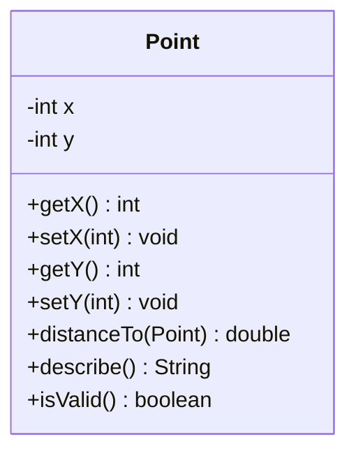

# Lab 1 — The Class Blueprint

Your first OOP lab. Everything else in this course builds on what you practise today: a **class** — a blueprint from which objects are made.

## What you will learn

- Writing a `class` with **attributes** (data) and **methods** (behaviour)
- Using **access specifiers** correctly (`private` attributes, `public` methods)
- Writing **getters** and **setters**, with validation built into every setter
- Reading input safely — the library's readers loop until the value is valid
- Creating **objects** and calling methods on them
- Drawing **UML class diagrams** to plan before coding
- **Signing your work** with `Session.me(...)` and `Console.watermark()`

## The two tools you will use in every problem

### 1. `Check` — validation that never throws

```java
Check.isName(value)               // Unicode-aware name check
Check.inRange(value, min, max)    // int or double
Check.notBlank(value)             // string
Check.minLength(value, n)         // string
```

Every setter uses one of these. If it returns `false`, the setter does nothing.

Full reference: <https://hyphensaad.github.io/chirp/chirp/text/Check.html>

### 2. `Chirp` readers — input that loops until valid

```java
readInt("Age", 1, 120)            // retries until a valid int in range
readDouble("GPA", 0.0, 4.0)       // retries until a valid double in range
readString("Name").notBlank().read()
```

The reader keeps asking until the user types something valid. In the demo, you never need to handle bad input — the reader does it for you.

Full reference: <https://hyphensaad.github.io/chirp/chirp/Chirp.html>

## Reference example — read this first

A complete class with the exact pattern every problem in this lab follows.

### UML



### Class

```java
import chirp.text.Check;

public class Point {

    private int x;
    private int y;

    public int getX() { return x; }

    public void setX(int value) {
        if (Check.inRange(value, -1000, 1000)) {
            this.x = value;
        }
    }

    public int getY() { return y; }

    public void setY(int value) {
        if (Check.inRange(value, -1000, 1000)) {
            this.y = value;
        }
    }

    public double distanceTo(Point other) {
        if (other == null) return 0;
        int dx = this.x - other.x;
        int dy = this.y - other.y;
        return Math.sqrt(dx * dx + dy * dy);
    }

    public String describe() {
        return "(" + x + ", " + y + ")";
    }

    public boolean isValid() {
        return Check.inRange(x, -1000, 1000)
                && Check.inRange(y, -1000, 1000);
    }
}
```

### Demo

```java
import chirp.console.Console;
import chirp.session.Session;
import static chirp.Chirp.*;

public class PointDemo {

    public static void main(String[] args) {
        start();

        Session.me()
                .name("Ayesha Khan")
                .rollNumber("2024-CS-001")
                .degree("BSCS")
                .batch("2024")
                .section("A");

        if (!Session.me().isComplete()) {
            Console.warn("Set your Session before submitting. Missing: "
                    + Session.me().missingFields());
        }

        int ax = readInt("Point A — x", -1000, 1000);
        int ay = readInt("Point A — y", -1000, 1000);

        Point a = new Point();
        a.setX(ax);
        a.setY(ay);

        Point b = new Point();
        b.setX(0);
        b.setY(0);

        Console.println();
        Console.println("A is at " + a.describe());
        Console.println("B is at " + b.describe());
        Console.println("Distance: " + a.distanceTo(b));

        int beforeX = a.getX();
        a.setX(2000);
        if (a.getX() == beforeX) {
            Console.warn("setX(2000) was rejected — x is still " + beforeX);
        }

        Console.println();
        Console.watermark();
    }
}
```

### Notice

- Every attribute is `private`.
- Every setter uses `Check` and silently rejects invalid values.
- `distanceTo` trusts the coordinates are valid — no redundant checks.
- `describe()` and `isValid()` read the current state.
- The demo uses `Session.isComplete()` and `Session.missingFields()` to warn if you forgot to sign.
- The demo verifies the safety net by calling `setX` with an invalid value.

## Workflow for every problem

1. **Read the problem's `README.md`** — context, UML, requirements, tests to pass.
2. **Run the problem's starter** — the runner copies `starter/` to `workspace/` on first use:
   ```bash
   ./run.ps1 -Lab 1 -Level 1 -Problem 1 -Operation run
   ```
3. **Fill in the TODOs** in `workspace/`.
4. **Test your work**:
   ```bash
   ./run.ps1 -Lab 1 -Level 1 -Problem 1 -Operation test
   ```
5. **Pack your submission when all tests pass**:
   ```bash
   ./run.ps1 -Lab 1 -Level 1 -Problem 1 -Operation pack
   ```

## How to submit

- Your `workspace/` folder as a ZIP — `./run.ps1 ... -Operation pack` creates it.
- The `PASS`/`FAIL` output of `./run.ps1 ... -Operation test`.
- A screenshot of `./run.ps1 ... -Operation run`.
- The UML you drew (Mermaid, or a photo of paper).

## The four levels

| Level | Badge | New idea | Scope |
|---|---|---|---|
| **1** |  | Getting the shape right | 2–3 attributes, simple methods |
| **2** |  | Computing answers | Methods that produce values |
| **3** |  | Branching on state | Methods with `if` inside |
| **4** |  | Mini systems | Realistic multi-rule classes |

Work through them in order.

---

Go to [`level-1/`](level-1/) to begin.
