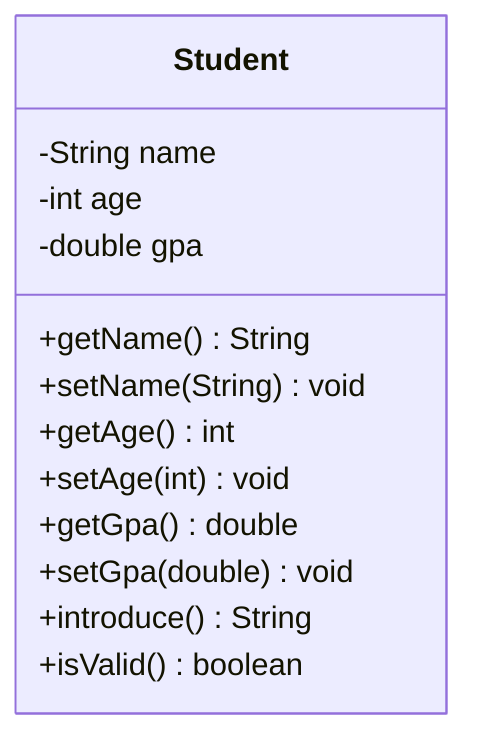

# Problem 1 — Student

**Level:** 1 | **Lab:** Class Blueprint

## Context

You are building a school management system. Start with a `Student` class that holds a student's name, age, and GPA, and can introduce itself.

## UML



## Requirements

| Attribute | Type | Rule |
|---|---|---|
| name | String | `Check.isName(value)` |
| age | int | `Check.inRange(value, 1, 120)` |
| gpa | double | `Check.inRange(value, 0.0, 4.0)` |

Defaults: `name = ""`, `age = 1`, `gpa = 0.0`.

### Behaviour

- `introduce()` returns `"Hi, I'm {name}. I'm {age} years old with a GPA of {gpa}."`
- `isValid()` returns `true` only when all three attributes are in range.

## Chirp methods used

| Method | What it does |
|---|---|
| `readNonEmpty(prompt)` | Read a non-blank string; loops until the user types something |
| `readInt(prompt, min, max)` | Read an integer; loops until within range |
| `readDouble(prompt, min, max)` | Read a decimal; loops until within range |
| `println(value)` | Print a value followed by a newline |
| `warn(message)` | Print a yellow warning line |
| `Check.isName(value)` | Return `true` if `value` is a valid person name |
| `Check.inRange(value, min, max)` | Return `true` if `value` is within `[min, max]` |

## Sample interaction

```
Name: Ayesha
Age: 20
GPA: 3.75

Hi, I'm Ayesha. I'm 20 years old with a GPA of 3.75.
Valid: true
⚠ setAge(200) was rejected — age is still 20
```

## Tests to pass

- `validStudentReportsIsValid`
- `attributesStoredCorrectly`
- `introduceContainsNameAndGpa`
- `ageAboveMaximumRejected` — `setAge(200)` rejected
- `ageBelowMinimumRejected` — `setAge(0)` rejected
- `negativeGpaRejected` — `setGpa(-1)` rejected
- `gpaAboveMaximumRejected` — `setGpa(5.0)` rejected
- `blankNameRejected` — `setName("   ")` rejected
- `nameWithDigitsRejected` — `setName("Ayesha123")` rejected (via `Check.isName`)
- `freshStudentIsNotValid` — defaults fail `isName` so `isValid()` is `false`

## Files

| Folder | What it contains |
|---|---|
| `starter/` | `Student.java` (empty class — implement it) + `StudentDemo.java` (full guide) |
| `solution/` | Reference implementation |
| `tests/` | JUnit tests |
