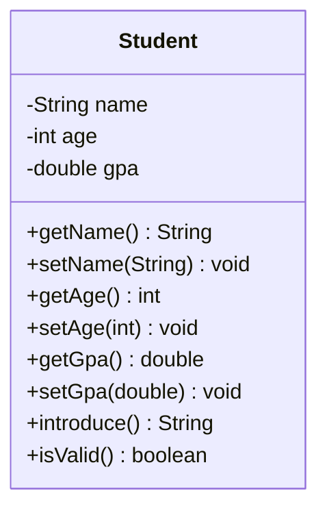

# Problem 1 — Student

**Level:** 1 | **Lab:** Class Blueprint

## Context

You are building a school management system. Start with a `Student` class that holds a student's name, age, and GPA, and can introduce itself.

## UML



## Requirements

### Attributes

| Attribute | Type | Validation method | Rule |
|---|---|---|---|
| name | String | `Check.isName(value)` | Any valid person name |
| age | int | `Check.inRange(value, 1, 120)` | 1 to 120 |
| gpa | double | `Check.inRange(value, 0.0, 4.0)` | 0.0 to 4.0 |

Defaults: `name = ""`, `age = 1`, `gpa = 0.0`. A fresh `Student` is **not** valid until `name` is set (empty string fails `Check.isName`).

### Behaviour

- `introduce()` returns `"Hi, I'm {name}. I'm {age} years old with a GPA of {gpa}."`
- `isValid()` returns `true` only when all three attributes are in range.

## Sample interaction

```
Name: Ayesha
Age: 20
GPA: 3.75

Hi, I'm Ayesha. I'm 20 years old with a GPA of 3.75.
Valid: true
⚠ setAge(200) was rejected — age is still 20
```

## Chirp methods used

- [`Check.isName(String)`](https://hyphensaad.github.io/chirp/chirp/text/Check.html#isName(java.lang.String))
- [`Check.inRange(int, int, int)`](https://hyphensaad.github.io/chirp/chirp/text/Check.html#inRange(int,int,int))
- [`Check.inRange(double, double, double)`](https://hyphensaad.github.io/chirp/chirp/text/Check.html#inRange(double,double,double))
- [`Chirp.readString(prompt)`](https://hyphensaad.github.io/chirp/chirp/Chirp.html#readString())
- [`Chirp.readInt(prompt, min, max)`](https://hyphensaad.github.io/chirp/chirp/Chirp.html#readInt(java.lang.String,int,int))
- [`Chirp.readDouble(prompt, min, max)`](https://hyphensaad.github.io/chirp/chirp/Chirp.html#readDouble(java.lang.String,double,double))
- [`Session.isComplete()`](https://hyphensaad.github.io/chirp/chirp/session/Session.html#isComplete())
- [`Session.missingFields()`](https://hyphensaad.github.io/chirp/chirp/session/Session.html#missingFields())
- [`Console.watermark()`](https://hyphensaad.github.io/chirp/chirp/console/Console.html#watermark())

## Tests to pass

- `validStudentReportsIsValid` — a fully-set student reports `isValid`
- `attributesStoredCorrectly` — setters store the right values
- `introduceContainsNameAndGpa` — the summary string is correct
- `ageAboveMaximumRejected` — `setAge(200)` is silently rejected
- `ageBelowMinimumRejected` — `setAge(0)` is silently rejected
- `negativeGpaRejected` — `setGpa(-1)` is silently rejected
- `gpaAboveMaximumRejected` — `setGpa(5.0)` is silently rejected
- `blankNameRejected` — `setName("   ")` is silently rejected
- `nameWithDigitsRejected` — `setName("Ayesha123")` is silently rejected
- `freshStudentIsNotValid` — a fresh `Student` is not valid

## How to run

```bash
cd labs
./run.ps1 -Lab 1 -Level 1 -Problem 1 -Operation run,test
```

## Files

| Folder | Purpose |
|---|---|
| `starter/` | Skeleton to begin from |
| `solution/` | Reference implementation |
| `tests/` | JUnit tests that must pass |
