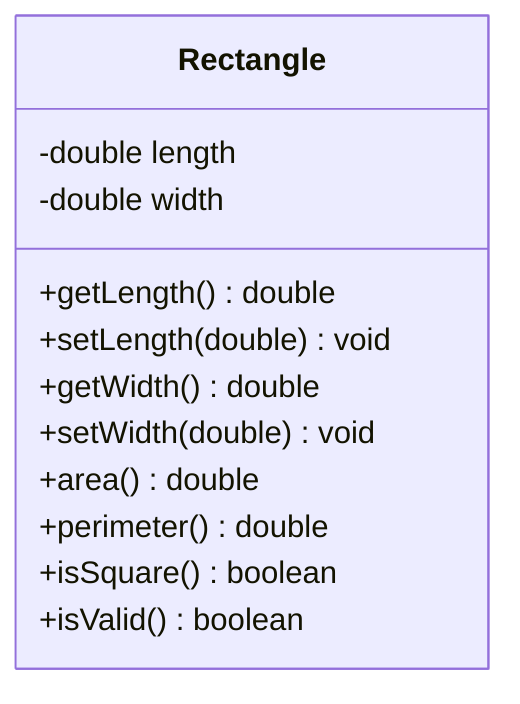

# Problem 2 — Rectangle

**Level:** 1 | **Lab:** Class Blueprint

## Context

A small geometry tool. A `Rectangle` stores length and width and reports its area, perimeter, and whether it is a square.

## UML



## Requirements

| Attribute | Type | Rule |
|---|---|---|
| length | double | `> 0` |
| width | double | `> 0` |

Defaults: `length = 1.0`, `width = 1.0`.

### Behaviour

- `area()` = `length * width`
- `perimeter()` = `2 * (length + width)`
- `isSquare()` = `length == width`

## Chirp methods used

| Method | What it does |
|---|---|
| `readDouble(prompt, min, max)` | Read a decimal; loops until in range |
| `println(value)` | Print a value followed by a newline |
| `warn(message)` | Print a yellow warning line |
| `Check.inRange(value, min, max)` | Return `true` if `value` is within `[min, max]` |

## Sample interaction

```
Length: 8
Width: 5

Area:      40.00
Perimeter: 26.00
Is square: false
⚠ setLength(0) was rejected — length is still 8.00
```

## Tests to pass

- `validRectangleReportsIsValid`
- `areaIsCorrect` — 8 × 5 = 40
- `perimeterIsCorrect` — 2 × (8 + 5) = 26
- `notASquareWhenLengthDiffersFromWidth`
- `squareWhenLengthEqualsWidth`
- `zeroLengthRejected`
- `negativeWidthRejected`

## Files

`starter/` (Rectangle.java empty + demo guide) · `solution/` · `tests/`
