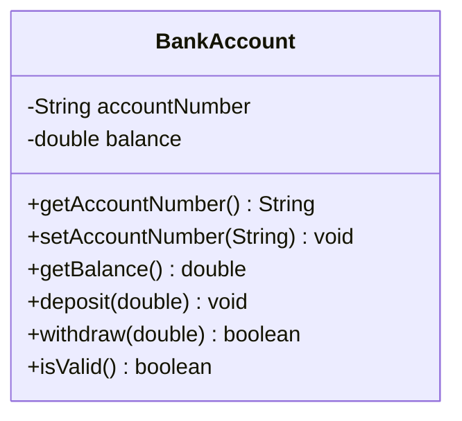

# Problem 3 — BankAccount

**Level:** 1 | **Lab:** Class Blueprint

## Context

A small banking app. A `BankAccount` holds an account number and a balance. Money can only move in or out via `deposit` and `withdraw` — there is **no setter** for the balance.

## UML



## Requirements

| Attribute | Type | Rule |
|---|---|---|
| accountNumber | String | `Check.notBlank(value)` |
| balance | double | `>= 0` (starts at 0, no setter) |

### Behaviour

- `deposit(amount)` — if `amount > 0`, adds to balance. Invalid amounts silently rejected.
- `withdraw(amount)` — returns `true` and reduces balance when `0 < amount <= balance`. Otherwise returns `false`.

## Chirp methods used

| Method | What it does |
|---|---|
| `readNonEmpty(prompt)` | Read a non-blank string; loops until valid |
| `readDouble(prompt, min, max)` | Read a decimal; loops until in range |
| `println(value)` | Print a value followed by a newline |
| `warn(message)` | Print a yellow warning line |
| `rupees(amount)` | Format a decimal as `Rs.1,234.56` |
| `Check.notBlank(value)` | Return `true` if `value` is not null/empty/whitespace |

## Sample interaction

```
Account number: ACC-1001
Deposit 1: 500
Balance after deposit 1: Rs.500.00
Deposit 2: 300
Balance after deposit 2: Rs.800.00
Withdraw 1: 200
Withdraw 1: accepted — balance: Rs.600.00
⚠ deposit(-100) was rejected — balance is still Rs.600.00
```

## Tests to pass

- `validAccountReportsIsValid`
- `initialBalanceIsZero`
- `depositIncreasesBalance`
- `withdrawReducesBalanceAndReturnsTrue`
- `overWithdrawReturnsFalseAndKeepsBalance`
- `negativeDepositRejected`
- `zeroWithdrawReturnsFalse`
- `blankAccountNumberRejected`
- `freshAccountWithoutNumberNotValid`

## Files

`starter/` (BankAccount.java empty + demo guide) · `solution/` · `tests/`
