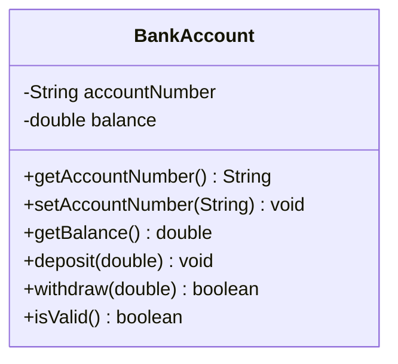

# Problem 3 — BankAccount

**Level:** 1 | **Lab:** Class Blueprint

## Context

A small banking app. A `BankAccount` holds an account number and a balance. Money can only move in or out via `deposit` and `withdraw` — there is **no setter** for the balance.

## UML



## Requirements

| Attribute | Type | Rule |
|---|---|---|
| accountNumber | String | `Check.notBlank(value)` |
| balance | double | >= 0 (start at 0, no setter) |

### Behaviour

- `deposit(amount)` — if `amount > 0`, adds to balance. Invalid amounts are silently rejected.
- `withdraw(amount)` — returns `true` and reduces balance when `amount > 0` and `amount <= balance`. Otherwise returns `false`.

## Sample interaction

```
Deposit 500   -> balance: Rs.500.00
Deposit 300   -> balance: Rs.800.00
Withdraw 200  -> true,  balance: Rs.600.00
Withdraw 999  -> false, balance: Rs.600.00
Withdraw -50  -> false, balance: Rs.600.00
```

## Chirp methods used

- [`Chirp.readString(prompt).notBlank().read()`](https://hyphensaad.github.io/chirp/javadoc/chirp/Chirp.html#readString())
- [`Chirp.readDouble(prompt).min(...).read()`](https://hyphensaad.github.io/chirp/javadoc/chirp/Chirp.html#readDouble())
- [`Chirp.rupees(amount)`](https://hyphensaad.github.io/chirp/javadoc/chirp/Chirp.html#rupees(double))
- [`Check.notBlank(String)`](https://hyphensaad.github.io/chirp/javadoc/chirp/text/Check.html#notBlank(java.lang.String))

## Tests to pass

- `validAccountReportsIsValid`
- `initialBalanceIsZero`
- `depositIncreasesBalance` (500 → 800)
- `withdrawReducesBalanceAndReturnsTrue`
- `overWithdrawReturnsFalseAndKeepsBalance`
- `negativeDepositRejected`
- `zeroWithdrawReturnsFalse`
- `blankAccountNumberRejected`
- `negativeBalanceRejectedByConstructor` (balance never goes below zero via operations)

## Files

`starter/` · `solution/` · `tests/`
