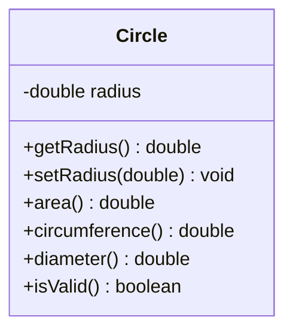

# Problem 4 — Circle

**Level:** 1 | **Lab:** Class Blueprint

## Context

Another shape for the geometry tool. A `Circle` stores a radius and reports diameter, area, and circumference.

## UML



## Requirements

| Attribute | Type | Rule |
|---|---|---|
| radius | double | > 0 |

Default: `radius = 1.0`.

### Behaviour

- `area()` = `Math.PI * radius * radius`
- `circumference()` = `2 * Math.PI * radius`
- `diameter()` = `2 * radius`

## Sample interaction

```
Radius: 5

Diameter:      10.00
Area:          78.54
Circumference: 31.42
```

## Chirp methods used

- [`Chirp.readDouble(prompt).min(...).read()`](https://hyphensaad.github.io/chirp/javadoc/chirp/Chirp.html#readDouble())
- [`Chirp.decimal(value, 2)`](https://hyphensaad.github.io/chirp/javadoc/chirp/Chirp.html#decimal(double,int))
- [`Check.inRange(double, double, double)`](https://hyphensaad.github.io/chirp/javadoc/chirp/text/Check.html#inRange(double,double,double))

## Tests to pass

- `validCircleReportsIsValid`
- `diameterIsDoubleRadius`
- `areaIsPiRSquared`
- `circumferenceIs2PiR`
- `zeroRadiusRejected`
- `negativeRadiusRejected`
- `defaultRadiusIsOne`

## Files

`starter/` · `solution/` · `tests/`
