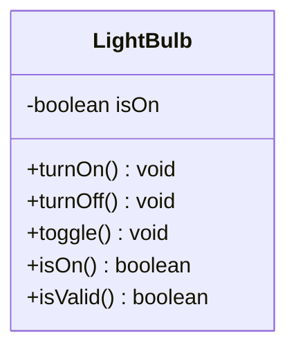

# Problem 5 — LightBulb

**Level:** 1 | **Lab:** Class Blueprint

## Context

A very small simulation. A bulb that can be on or off, toggled, and inspected. This is the smallest class you can build — but it teaches the same lessons.

## UML



## Requirements

| Attribute | Type | Rule |
|---|---|---|
| isOn | boolean | start `false` |

No range validation is needed — any boolean is valid. But `isValid()` still exists and always returns `true`. That is a deliberate choice: every class in this course exposes `isValid()` so callers have one uniform way to ask "is this object in a usable state?".

### Behaviour

- `turnOn()` sets `isOn = true` (idempotent).
- `turnOff()` sets `isOn = false`.
- `toggle()` flips `isOn`.
- `isOn()` returns the current state.

## Sample interaction

```
Initial: on? false
turnOn()  -> on? true
toggle()  -> on? false
toggle()  -> on? true
turnOff() -> on? false
```

## Why this problem matters

1. Not every class needs range checks.
2. Every class still needs **consistent state** — a bulb is either on or off, never "half-on".
3. `isValid()` can honestly return `true` for a class with no constraints — the contract is "always valid".

## Chirp methods used

- [`Console.println(...)`](https://hyphensaad.github.io/chirp/javadoc/chirp/console/Console.html#println(java.lang.Object))
- [`Console.watermark()`](https://hyphensaad.github.io/chirp/javadoc/chirp/console/Console.html#watermark())
- [`Session.me()`](https://hyphensaad.github.io/chirp/javadoc/chirp/session/Session.html#me())

## Tests to pass

- `initialStateIsOff`
- `isValidAlwaysTrue`
- `turnOnMakesItOn`
- `turnOnIsIdempotent`
- `toggleFromOnToOff`
- `toggleFromOffToOn`
- `turnOffMakesItOff`

## Files

`starter/` · `solution/` · `tests/`
