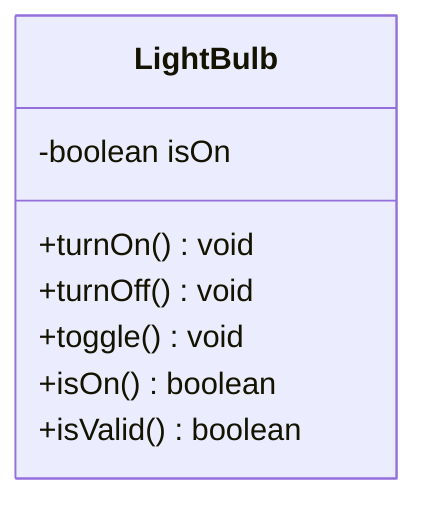

# Problem 5 — LightBulb

**Level:** 1 | **Lab:** Class Blueprint

## Context

A very small simulation — a bulb that can be on, off, or toggled. This is the smallest class you can build, and it teaches the same lessons: consistent state, clear operations, and an `isValid()` method.

## UML



## Requirements

| Attribute | Type | Rule |
|---|---|---|
| isOn | boolean | starts `false` |

No range validation is needed. `isValid()` still exists — it always returns `true` for this class. That's a deliberate contract: every class in this course exposes `isValid()` so callers have one uniform way to ask "is this object ready to use?"

### Behaviour

- `turnOn()` sets `isOn = true` (idempotent).
- `turnOff()` sets `isOn = false`.
- `toggle()` flips `isOn`.
- `isOn()` returns the current state.

## Chirp methods used

| Method | What it does |
|---|---|
| `println(value)` | Print a value followed by a newline |

That's it — this problem deliberately uses the smallest possible toolkit so the focus stays on the class shape.

## Sample interaction

```
Initial: on? false
turnOn()  → on? true
toggle()  → on? false
toggle()  → on? true
turnOff() → on? false
```

## Tests to pass

- `initialStateIsOff`
- `isValidAlwaysTrue`
- `turnOnMakesItOn`
- `turnOnIsIdempotent`
- `toggleFromOnToOff`
- `toggleFromOffToOn`
- `turnOffMakesItOff`

## Files

`starter/` (LightBulb.java empty + demo guide) · `solution/` · `tests/`
