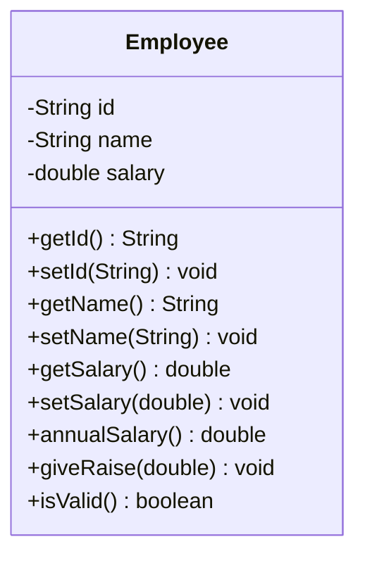

# Problem 6 — Employee

**Level:** 2 | **Lab:** Class Blueprint

## Context

A payroll system. An `Employee` has an ID, a name, and a monthly salary. The system computes annual salary and applies percentage raises.

## UML



## Requirements

| Attribute | Type | Validation method | Rule |
|---|---|---|---|
| id | String | `Check.notBlank(value)` | Any non-blank string |
| name | String | `Check.isName(value)` | A valid person name |
| salary | double | `Check.inRange(value, 0.01, Double.MAX_VALUE)` | > 0 |

Defaults: `id = ""`, `name = ""`, `salary = 0.0`.

### Behaviour

- `annualSalary()` = `salary * 12`
- `giveRaise(percent)` — increases `salary` by `percent` when `Check.inRange(percent, 0, 100)`. Invalid values silently rejected.

## Sample interaction

```
Employee ID: EMP-101
Name: Ali
Monthly salary: 50000

Employee: Ali (EMP-101)
Monthly: Rs.50,000.00
Annual:  Rs.600,000.00
Raise (%): 10
After 10.0% raise: Rs.55,000.00
⚠ giveRaise(-5) was rejected — salary is still Rs.55,000.00
```

## Chirp methods used

- [`Check.isName(String)`](https://hyphensaad.github.io/chirp/javadoc/chirp/text/Check.html#isName(java.lang.String))
- [`Check.notBlank(String)`](https://hyphensaad.github.io/chirp/javadoc/chirp/text/Check.html#notBlank(java.lang.String))
- [`Check.inRange(double, double, double)`](https://hyphensaad.github.io/chirp/javadoc/chirp/text/Check.html#inRange(double,double,double))
- [`Chirp.readString(prompt).notBlank().read()`](https://hyphensaad.github.io/chirp/javadoc/chirp/Chirp.html#readString())
- [`Chirp.readDouble(prompt).min(...).read()`](https://hyphensaad.github.io/chirp/javadoc/chirp/Chirp.html#readDouble())
- [`Chirp.readDouble(prompt, min, max)`](https://hyphensaad.github.io/chirp/javadoc/chirp/Chirp.html#readDouble(java.lang.String,double,double))
- [`Chirp.rupees(amount)`](https://hyphensaad.github.io/chirp/javadoc/chirp/Chirp.html#rupees(double))
- [`Console.watermark()`](https://hyphensaad.github.io/chirp/javadoc/chirp/console/Console.html#watermark())

## Tests to pass

- `validEmployeeReportsIsValid`
- `attributesStoredCorrectly`
- `annualSalaryIsMonthlyTimesTwelve`
- `giveRaiseIncreasesSalary`
- `giveRaiseZeroLeavesSalaryUnchanged`
- `negativeRaiseRejected`
- `raiseAboveHundredRejected`
- `zeroSalaryRejected`

## Files

`starter/` · `solution/` · `tests/`
