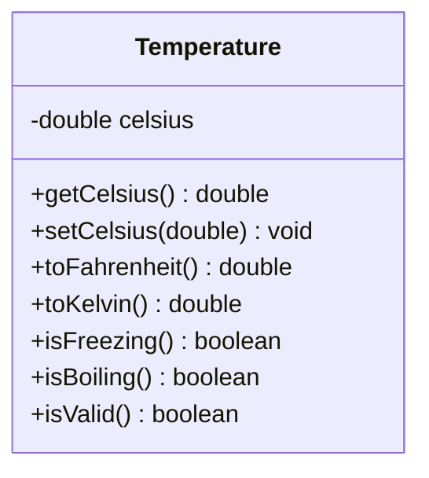

# Problem 7 — Temperature

**Level:** 2 | **Lab:** Class Blueprint

## Context

A weather app stores a temperature in Celsius and converts it to Fahrenheit and Kelvin on demand.

## UML



## Requirements

| Attribute | Type | Rule |
|---|---|---|
| celsius | double | `>= -273.15` (absolute zero) |

Default: `celsius = 0.0`.

### Behaviour

- `toFahrenheit()` = `celsius * 9/5 + 32`
- `toKelvin()` = `celsius + 273.15`
- `isFreezing()` = `celsius <= 0`
- `isBoiling()` = `celsius >= 100`

## Sample interaction

```
Celsius: 25

Fahrenheit: 77.00
Kelvin:     298.15
Freezing?   false
Boiling?    false
⚠ setCelsius(-300) was rejected — below absolute zero
```

## Chirp methods used

- [`Chirp.readDouble(prompt, min, max)`](https://hyphensaad.github.io/chirp/chirp/Chirp.html#readDouble(java.lang.String,double,double))
- [`Chirp.decimal(value, 2)`](https://hyphensaad.github.io/chirp/chirp/Chirp.html#decimal(double,int))
- [`Check.inRange(double, double, double)`](https://hyphensaad.github.io/chirp/chirp/text/Check.html#inRange(double,double,double))

## Tests to pass

- `validTemperatureReportsIsValid`
- `celsiusStoredCorrectly`
- `toFahrenheitIsCorrect` — 25°C → 77°F
- `toKelvinIsCorrect` — 25°C → 298.15K
- `isFreezingAtZeroOrBelow`
- `isBoilingAt100OrAbove`
- `belowAbsoluteZeroRejected`

## Files

`starter/` · `solution/` · `tests/`
