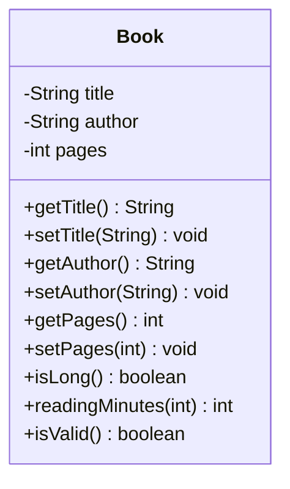

# Problem 8 — Book

**Level:** 2 | **Lab:** Class Blueprint

## Context

A library app stores a book's title, author, and page count. It reports whether the book is long and estimates reading time.

## UML



## Requirements

| Attribute | Type | Rule |
|---|---|---|
| title | String | `Check.notBlank(value)` |
| author | String | `Check.isName(value)` |
| pages | int | `Check.inRange(value, 1, Integer.MAX_VALUE)` |

Defaults: `title = ""`, `author = ""`, `pages = 1`.

### Behaviour

- `isLong()` = `pages > 300`
- `readingMinutes(secondsPerPage)` = `(pages * secondsPerPage) / 60` (integer division)
  - When `secondsPerPage <= 0`, returns `0` (invalid input, safe default)

## Sample interaction

```
Title: Clean Code
Author: Robert Martin
Pages: 464

Book: Clean Code by Robert Martin
Pages: 464
Is long? true
Reading time (60s/page): 464 minutes
Reading time (30s/page): 232 minutes
Reading time (0s/page):  0 minutes (invalid input, defaults to 0)
```

## Chirp methods used

- [`Check.isName(String)`](https://hyphensaad.github.io/chirp/chirp/text/Check.html#isName(java.lang.String))
- [`Check.notBlank(String)`](https://hyphensaad.github.io/chirp/chirp/text/Check.html#notBlank(java.lang.String))
- [`Check.inRange(int, int, int)`](https://hyphensaad.github.io/chirp/chirp/text/Check.html#inRange(int,int,int))
- [`Chirp.readInt(prompt, min, max)`](https://hyphensaad.github.io/chirp/chirp/Chirp.html#readInt(java.lang.String,int,int))
- [`Chirp.readString(prompt).notBlank().read()`](https://hyphensaad.github.io/chirp/chirp/Chirp.html#readString())

## Tests to pass

- `validBookReportsIsValid`
- `attributesStoredCorrectly`
- `isLongAbove300Pages`
- `readingMinutesCalculatesCorrectly`
- `invalidSecondsPerPageReturnsZero`
- `blankTitleRejected`
- `zeroPagesRejected`

## Files

`starter/` · `solution/` · `tests/`
