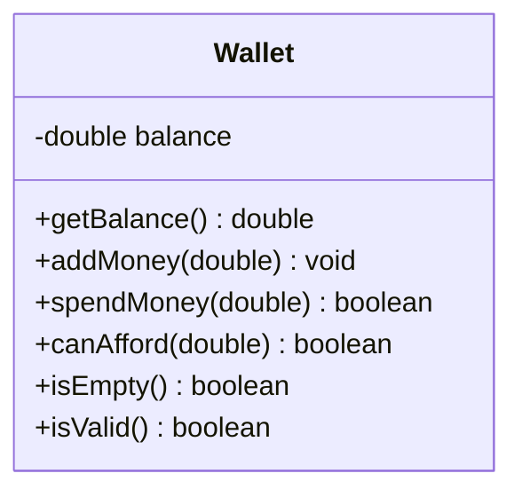

# Problem 9 — Wallet

**Level:** 2 | **Lab:** Class Blueprint

## Context

A budgeting helper. A `Wallet` holds cash. Money can only move in or out via `addMoney` and `spendMoney` — there is **no setter** for the balance.

## UML



## Requirements

| Attribute | Type | Rule |
|---|---|---|
| balance | double | `>= 0` (start at 0, no setter) |

### Behaviour

- `addMoney(amount)` — if `amount > 0`, adds to balance. Invalid amounts silently rejected.
- `spendMoney(amount)` — returns `true` and reduces balance when `0 < amount <= balance`. Otherwise returns `false`.
- `canAfford(amount)` — returns `balance >= amount` (no state change).
- `isEmpty()` — returns `balance == 0`.

## Sample interaction

```
Start balance: Rs.0.00
isEmpty? true
Add amount: 500
Balance after add: Rs.500.00
Spend amount: 200
Spend: accepted — balance: Rs.300.00
canAfford(100)? true
⚠ addMoney(-50) was rejected — balance is still Rs.300.00
```

## Chirp methods used

- [`Chirp.readDouble(prompt).min(...).read()`](https://hyphensaad.github.io/chirp/chirp/Chirp.html#readDouble())
- [`Chirp.rupees(amount)`](https://hyphensaad.github.io/chirp/chirp/Chirp.html#rupees(double))

## Tests to pass

- `freshWalletIsValid`
- `initialBalanceIsZero`
- `addMoneyIncreasesBalance`
- `spendMoneyReducesBalanceAndReturnsTrue`
- `overspendReturnsFalse`
- `canAffordChecksCorrectly`
- `negativeAddRejected`
- `zeroSpendReturnsFalse`
- `spendUntilEmpty`

## Files

`starter/` · `solution/` · `tests/`
