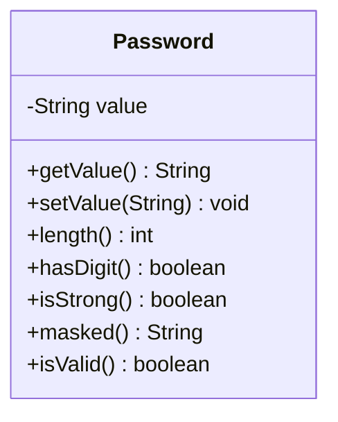

# Problem 10 — Password

**Level:** 2 | **Lab:** Class Blueprint

## Context

A sign-up form needs to check password strength. The password itself must never be shown — only a masked version.

## UML



## Requirements

| Attribute | Type | Rule |
|---|---|---|
| value | String | not null (empty allowed to start) |

Default: `value = ""`.

### Behaviour

- `length()` returns `value.length()`.
- `hasDigit()` uses `Check.containsDigit(value)`.
- `isStrong()` returns `true` when `Check.minLength(value, 8)` **and** `hasDigit()`.
- `masked()` returns one `*` per character — using `Text.mask(value, 0)`.

## Sample interaction

```
Password: abc

Length:    3
Has digit: false
Is strong: false
Masked:    ***
```

## Chirp methods used

- [`Check.containsDigit(String)`](https://hyphensaad.github.io/chirp/javadoc/chirp/text/Check.html#containsDigit(java.lang.String))
- [`Check.minLength(String, int)`](https://hyphensaad.github.io/chirp/javadoc/chirp/text/Check.html#minLength(java.lang.String,int))
- [`Text.mask(String, int)`](https://hyphensaad.github.io/chirp/javadoc/chirp/text/Text.html#mask(java.lang.String,int))
- [`Chirp.readString(prompt).read()`](https://hyphensaad.github.io/chirp/javadoc/chirp/Chirp.html#readString())

## Tests to pass

- `freshPasswordIsValid`
- `setValueStoresCorrectly`
- `lengthReturnsCorrectValue`
- `hasDigitDetectsDigits`
- `isStrongRequiresLengthAndDigit`
- `maskedReturnsStarsOnly`
- `nullValueRejected`

## Files

`starter/` · `solution/` · `tests/`
