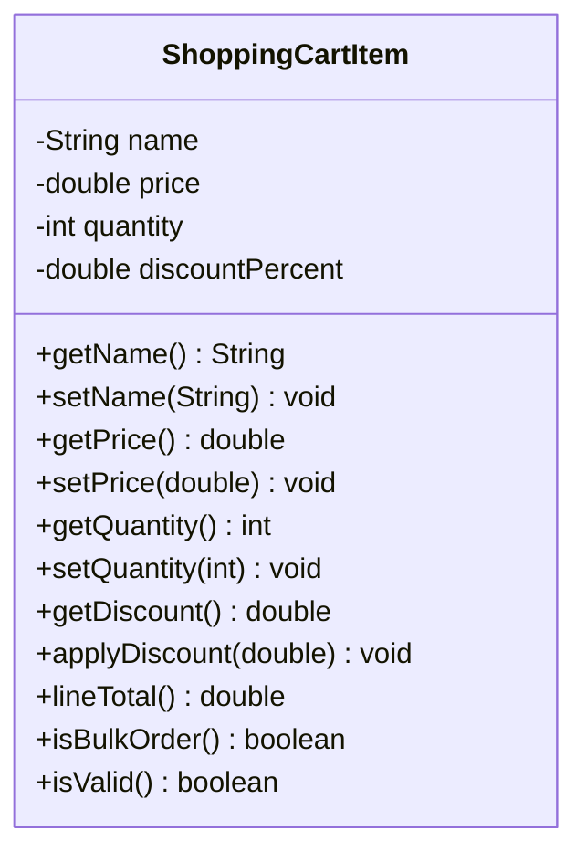

# Problem 11 — ShoppingCartItem

**Level:** 3 | **Lab:** Class Blueprint

## Context

A shopping cart holds items. Each item has a name, price, quantity, and an optional discount percentage. Bulk orders (quantity ≥ 5) are flagged, and discounts adjust the line total.

## UML



## Requirements

| Attribute | Type | Rule |
|---|---|---|
| name | String | `Check.notBlank(value)` |
| price | double | `> 0` |
| quantity | int | `>= 1` |
| discountPercent | double | `0` to `100` (default `0`) |

### Behaviour

- `lineTotal()` = `price * quantity * (1 - discountPercent / 100)`
- `isBulkOrder()` = `quantity >= 5`
- `applyDiscount(percent)` sets `discountPercent` when `Check.inRange(percent, 0, 100)`. Invalid values silently rejected.

## Sample interaction

```
Item name: Notebook
Unit price: 150
Quantity: 6

Item: Notebook x 6 @ Rs.150.00
Line total: Rs.900.00
Bulk order? true
Discount (%): 10
After 10%: Rs.810.00
⚠ applyDiscount(150) was rejected — discount is still 10%
```

## Chirp methods used

- [`Check.notBlank(String)`](https://hyphensaad.github.io/chirp/javadoc/chirp/text/Check.html#notBlank(java.lang.String))
- [`Check.inRange(double, double, double)`](https://hyphensaad.github.io/chirp/javadoc/chirp/text/Check.html#inRange(double,double,double))
- [`Check.inRange(int, int, int)`](https://hyphensaad.github.io/chirp/javadoc/chirp/text/Check.html#inRange(int,int,int))
- [`Chirp.readNonEmpty(prompt)`](https://hyphensaad.github.io/chirp/javadoc/chirp/Chirp.html#readNonEmpty(java.lang.String))
- [`Chirp.readDouble(prompt, min, max)`](https://hyphensaad.github.io/chirp/javadoc/chirp/Chirp.html#readDouble(java.lang.String,double,double))
- [`Chirp.readInt(prompt, min, max)`](https://hyphensaad.github.io/chirp/javadoc/chirp/Chirp.html#readInt(java.lang.String,int,int))
- [`Chirp.rupees(amount)`](https://hyphensaad.github.io/chirp/javadoc/chirp/Chirp.html#rupees(double))
- [`Chirp.decimal(value, places)`](https://hyphensaad.github.io/chirp/javadoc/chirp/Chirp.html#decimal(double,int))

## Tests to pass

- `validItemReportsIsValid`
- `lineTotalWithoutDiscount` — 6 × 150 = 900
- `isBulkOrderAtFiveOrMore`
- `applyDiscountChangesLineTotal` — 10% off → 810
- `invalidDiscountRejected` — 150 and −5 both rejected
- `zeroPriceRejected`
- `zeroQuantityRejected`
- `blankNameRejected`

## Files

`starter/` · `solution/` · `tests/`
