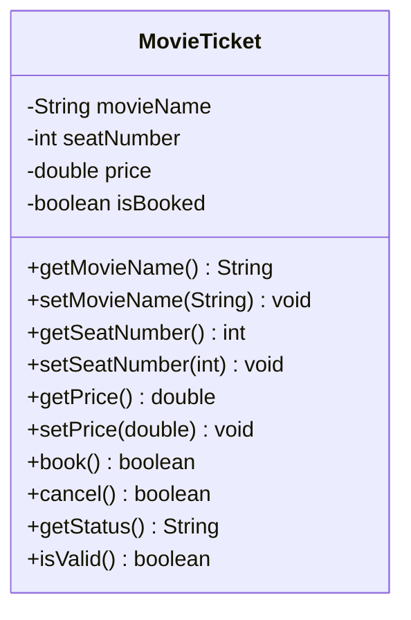

# Problem 12 — MovieTicket

**Level:** 3 | **Lab:** Class Blueprint

## Context

A cinema box office tracks a single seat for a movie. The seat is either **Available** or **Booked** — never anything in between.

## UML



## Requirements

| Attribute | Type | Rule |
|---|---|---|
| movieName | String | `Check.notBlank(value)` |
| seatNumber | int | `1` to `100` |
| price | double | `> 0` |
| isBooked | boolean | start `false` |

### Behaviour

- `book()` — if `isBooked` is already `true`, returns `false`. Otherwise sets `isBooked = true`, returns `true`.
- `cancel()` — if not booked, returns `false`. Otherwise sets `isBooked = false`, returns `true`.
- `getStatus()` — `"Booked"` or `"Available"`.

## Sample interaction

```
Movie: Inception
Seat number: 25
Price: 1200

Status: Available
Book: true
Status: Booked
Book again: false
Cancel: true
Status: Available
Cancel again: false
```

## Chirp methods used

- [`Check.notBlank(String)`](https://hyphensaad.github.io/chirp/chirp/text/Check.html#notBlank(java.lang.String))
- [`Check.inRange(int, int, int)`](https://hyphensaad.github.io/chirp/chirp/text/Check.html#inRange(int,int,int))
- [`Check.inRange(double, double, double)`](https://hyphensaad.github.io/chirp/chirp/text/Check.html#inRange(double,double,double))
- [`Chirp.readNonEmpty(prompt)`](https://hyphensaad.github.io/chirp/chirp/Chirp.html#readNonEmpty(java.lang.String))
- [`Chirp.readInt(prompt, min, max)`](https://hyphensaad.github.io/chirp/chirp/Chirp.html#readInt(java.lang.String,int,int))
- [`Chirp.readDouble(prompt, min, max)`](https://hyphensaad.github.io/chirp/chirp/Chirp.html#readDouble(java.lang.String,double,double))
- [`Chirp.rupees(amount)`](https://hyphensaad.github.io/chirp/chirp/Chirp.html#rupees(double))

## Tests to pass

- `validTicketReportsIsValid`
- `startsAvailable`
- `bookSetsBooked`
- `bookWhenBookedReturnsFalse`
- `cancelSetsAvailable`
- `cancelWhenAvailableReturnsFalse`
- `getStatusReflectsState`
- `invalidSeatNumberRejected` (0 and 150)

## Files

`starter/` · `solution/` · `tests/`
