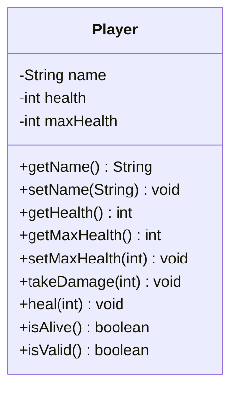

# Problem 13 — Player

**Level:** 3 | **Lab:** Class Blueprint

## Context

A simple game character with health that can go up (heal) or down (damage), but never outside `[0, maxHealth]`.

## UML



## Requirements

| Attribute | Type | Rule |
|---|---|---|
| name | String | `Check.isName(value)` |
| health | int | `0` to `maxHealth` (starts at `maxHealth`) |
| maxHealth | int | `> 0` |

Note: `health` has **no direct setter** — it can only change via `takeDamage` / `heal` (and via `setMaxHealth` lowering the max).

### Behaviour

- `takeDamage(amount)` — if `amount > 0`, reduces health by `amount`, capped at 0.
- `heal(amount)` — if `amount > 0`, increases health by `amount`, capped at `maxHealth`.
- `setMaxHealth(value)` — if `1 <= value`, sets max; if current health exceeds new max, health is capped at new max.
- `isAlive()` — `health > 0`.

## Sample interaction

```
Player name: Saad
Max health: 100

Saad (100 / 100), alive: true
Damage: 30
Saad (70 / 100), alive: true
Damage: 80
Saad (0 / 100), alive: false
Heal: 500
Saad (100 / 100), alive: true
```

## Chirp methods used

- [`Check.isName(String)`](https://hyphensaad.github.io/chirp/javadoc/chirp/text/Check.html#isName(java.lang.String))
- [`Check.inRange(int, int, int)`](https://hyphensaad.github.io/chirp/javadoc/chirp/text/Check.html#inRange(int,int,int))
- [`Chirp.readNonEmpty(prompt)`](https://hyphensaad.github.io/chirp/javadoc/chirp/Chirp.html#readNonEmpty(java.lang.String))
- [`Chirp.readInt(prompt, min, max)`](https://hyphensaad.github.io/chirp/javadoc/chirp/Chirp.html#readInt(java.lang.String,int,int))

## Tests to pass

- `validPlayerReportsIsValid`
- `startsWithFullHealth`
- `takeDamageReducesHealth`
- `damageCannotGoBelowZero`
- `healCannotGoAboveMax`
- `healFromZeroRevivesPlayer`
- `setMaxHealthBelowCurrentCapsHealth`
- `negativeDamageRejected`

## Files

`starter/` · `solution/` · `tests/`
