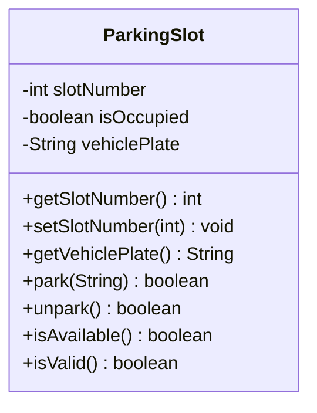

# Problem 14 — ParkingSlot

**Level:** 3 | **Lab:** Class Blueprint

## Context

A parking lot has slots. Each slot is either **free** or **occupied by a specific vehicle**. Parking puts a plate in; unparking clears it.

## UML



## Requirements

| Attribute | Type | Rule |
|---|---|---|
| slotNumber | int | `1` to `999` |
| isOccupied | boolean | start `false` |
| vehiclePlate | String | `null` when free, not blank when parked |

### Behaviour

- `park(plate)` — if already occupied, returns `false`. If `!Check.notBlank(plate)`, returns `false`. Otherwise sets `isOccupied = true`, `vehiclePlate = plate`, returns `true`.
- `unpark()` — if not occupied, returns `false`. Otherwise clears both, returns `true`.
- `isAvailable()` — `!isOccupied`.

## Sample interaction

```
Slot number: 12

Available: true
Park (plate): LEB-1234
Park: true — plate: LEB-1234
Park (plate): XYZ-9999
Park: false (slot is occupied)
Unpark: true — available again
Unpark again: false
```

## Chirp methods used

- [`Check.inRange(int, int, int)`](https://hyphensaad.github.io/chirp/chirp/text/Check.html#inRange(int,int,int))
- [`Check.notBlank(String)`](https://hyphensaad.github.io/chirp/chirp/text/Check.html#notBlank(java.lang.String))
- [`Chirp.readInt(prompt, min, max)`](https://hyphensaad.github.io/chirp/chirp/Chirp.html#readInt(java.lang.String,int,int))
- [`Chirp.readNonEmpty(prompt)`](https://hyphensaad.github.io/chirp/chirp/Chirp.html#readNonEmpty(java.lang.String))

## Tests to pass

- `validSlotReportsIsValid`
- `startsAvailableWithNullPlate`
- `parkSetsOccupiedAndStoresPlate`
- `parkWhenOccupiedReturnsFalse`
- `parkWithBlankPlateReturnsFalse`
- `unparkClearsState`
- `unparkWhenAvailableReturnsFalse`
- `invalidSlotNumberRejected` (0 and 1000)
- `isAvailableReflectsState`

## Files

`starter/` · `solution/` · `tests/`
