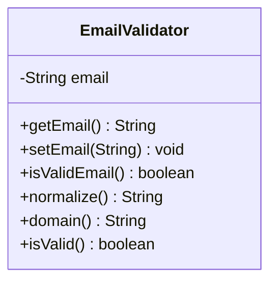

# Problem 15 — EmailValidator

**Level:** 3 | **Lab:** Class Blueprint

## Context

A sign-up form needs to validate an email address **before** accepting it. Unlike earlier problems, the setter does not reject invalid emails — it just stores them. A separate `isValidEmail()` method reports whether the stored email is acceptable.

## UML



## Requirements

| Attribute | Type | Rule |
|---|---|---|
| email | String | not null (empty allowed to start) |

`setEmail(value)` trims whitespace and stores. `null` input keeps the current value.

### Behaviour

- `isValidEmail()` — uses `Check.isEmail(email)` (returns false for empty).
- `normalize()` — trims (already done by setter), then lowercases everything from `@` onwards. Example: `"Saad@Example.COM"` → `"Saad@example.com"`.
- `domain()` — returns the part after `@`, or `""` when the email is invalid. `"Saad@Example.COM"` → `"Example.COM"` (as stored).

## Sample interaction

```
Email:   Saad@Example.COM

Valid email? true
Normalized:  Saad@example.com
Domain:      Example.COM
```

## Chirp methods used

- [`Check.isEmail(String)`](https://hyphensaad.github.io/chirp/javadoc/chirp/text/Check.html#isEmail(java.lang.String))
- [`Check.notNull(Object)`](https://hyphensaad.github.io/chirp/javadoc/chirp/text/Check.html#notNull(java.lang.Object))
- [`Chirp.readString(prompt)`](https://hyphensaad.github.io/chirp/javadoc/chirp/Chirp.html#readString())

## Tests to pass

- `freshValidatorIsValid` (email `""` is not null → isValid true)
- `setEmailStoresTrimmedValue`
- `setEmailNullRejected`
- `validEmailReturnsTrue`
- `invalidEmailReturnsFalse`
- `normalizeLowercasesAfterAt`
- `domainReturnsAfterAt`
- `domainReturnsEmptyForInvalid`

## Files

`starter/` · `solution/` · `tests/`
