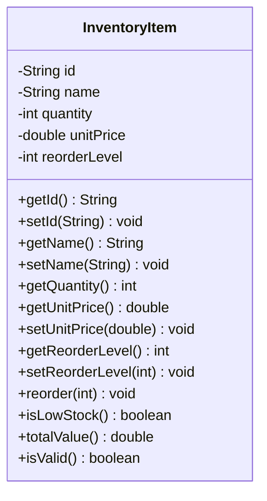

# Problem 16 — InventoryItem

**Level:** 4 | **Lab:** Class Blueprint

## Context

A shop tracks stock of each product. When stock falls to the reorder level, the item is flagged for reordering. `quantity` has no direct setter — stock only changes through `reorder()`.

## UML



## Requirements

| Attribute | Type | Rule |
|---|---|---|
| id | String | `Check.notBlank(value)` |
| name | String | `Check.notBlank(value)` |
| quantity | int | `>= 0` (start 0, no setter) |
| unitPrice | double | `> 0` |
| reorderLevel | int | `>= 0` |

### Behaviour

- `reorder(amount)` — if `amount > 0`, increases `quantity` by `amount`. Invalid amounts silently rejected.
- `isLowStock()` — `quantity <= reorderLevel`
- `totalValue()` — `quantity * unitPrice`

## Sample interaction

```
Item ID: ST-101
Item name: Pen
Unit price: 25
Reorder level: 5

Item: Pen (ST-101) @ Rs.25.00
Initial quantity: 0, reorder level: 5
isLowStock? true
totalValue: Rs.0.00
Reorder amount: 20
After reorder: 20
isLowStock? false
totalValue: Rs.500.00
```

## Chirp methods used

- [`Check.notBlank(String)`](https://hyphensaad.github.io/chirp/javadoc/chirp/text/Check.html#notBlank(java.lang.String))
- [`Check.inRange(int, int, int)`](https://hyphensaad.github.io/chirp/javadoc/chirp/text/Check.html#inRange(int,int,int))
- [`Check.inRange(double, double, double)`](https://hyphensaad.github.io/chirp/javadoc/chirp/text/Check.html#inRange(double,double,double))
- [`Chirp.readNonEmpty(prompt)`](https://hyphensaad.github.io/chirp/javadoc/chirp/Chirp.html#readNonEmpty(java.lang.String))
- [`Chirp.readInt(prompt, min, max)`](https://hyphensaad.github.io/chirp/javadoc/chirp/Chirp.html#readInt(java.lang.String,int,int))
- [`Chirp.readDouble(prompt, min, max)`](https://hyphensaad.github.io/chirp/javadoc/chirp/Chirp.html#readDouble(java.lang.String,double,double))
- [`Chirp.rupees(amount)`](https://hyphensaad.github.io/chirp/javadoc/chirp/Chirp.html#rupees(double))

## Tests to pass

- `validItemReportsIsValid`
- `startsAtZeroQuantity`
- `reorderIncreasesQuantity`
- `reorderZeroOrNegativeRejected`
- `isLowStockWhenQuantityAtOrBelowLevel`
- `totalValueCalculatesCorrectly`
- `zeroUnitPriceRejected`
- `blankIdRejected`
- `blankNameRejected`

## Files

`starter/` · `solution/` · `tests/`
