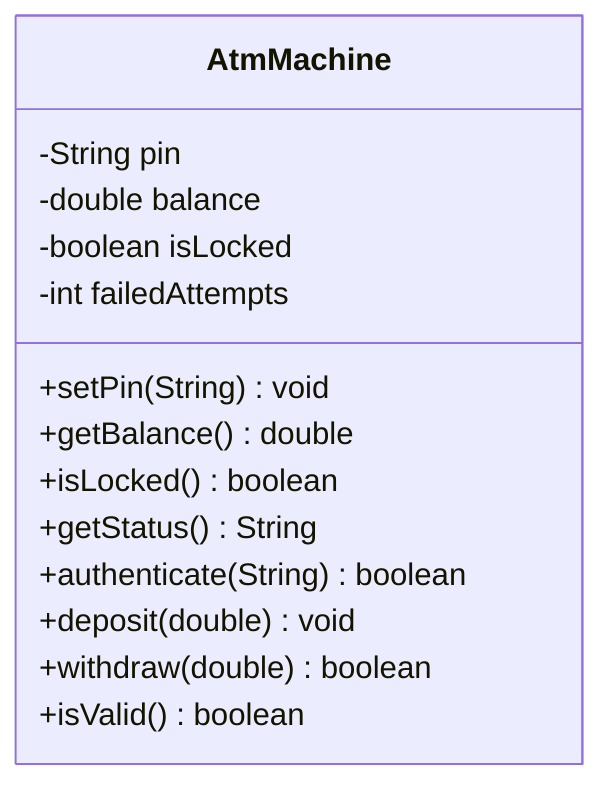

# Problem 17 — AtmMachine

**Level:** 4 | **Lab:** Class Blueprint

## Context

A simplified ATM. One PIN. Locks after three failed authentication attempts. Once locked, no operations are allowed.

## UML



## Requirements

| Attribute | Type | Rule |
|---|---|---|
| pin | String | `Check.isDigits(value) && Check.hasLength(value, 4)` (start `"1234"`) |
| balance | double | `>= 0` (start 0, no setter) |
| isLocked | boolean | start `false` |
| failedAttempts | int | `0` to `3` (no setter) |

### Behaviour

- `authenticate(enteredPin)` — if locked, returns `false`. If matches stored pin, resets `failedAttempts` to 0, returns `true`. Otherwise increments `failedAttempts`; when it reaches 3, sets `isLocked = true`; returns `false`.
- `deposit(amount)` — if locked or `amount <= 0`, silent reject. Otherwise adds to balance.
- `withdraw(amount)` — if locked, returns `false`. If `amount <= 0`, returns `false`. If `amount > balance`, returns `false`. Otherwise reduces balance and returns `true`.
- `getStatus()` — `"Locked"` or `"Active"`.

## Sample interaction

```
PIN is 1234, balance Rs.0.00
Try wrong PIN: 0000 -> false (attempt 1)
Try wrong PIN: 1111 -> false (attempt 2)
Try wrong PIN: 9999 -> false (attempt 3) -> LOCKED
deposit 100     -> silently rejected (locked)
```

## Chirp methods used

- [`Check.isDigits(String)`](https://hyphensaad.github.io/chirp/javadoc/chirp/text/Check.html#isDigits(java.lang.String))
- [`Check.hasLength(String, int)`](https://hyphensaad.github.io/chirp/javadoc/chirp/text/Check.html#hasLength(java.lang.String,int))
- [`Check.inRange(double, double, double)`](https://hyphensaad.github.io/chirp/javadoc/chirp/text/Check.html#inRange(double,double,double))
- [`Chirp.readString(prompt)`](https://hyphensaad.github.io/chirp/javadoc/chirp/Chirp.html#readString())
- [`Chirp.readDouble(prompt, min, max)`](https://hyphensaad.github.io/chirp/javadoc/chirp/Chirp.html#readDouble(java.lang.String,double,double))
- [`Chirp.rupees(amount)`](https://hyphensaad.github.io/chirp/javadoc/chirp/Chirp.html#rupees(double))

## Tests to pass

- `defaultPinIsValid`
- `setPinRejectsInvalidFormat` (non-digits, wrong length)
- `authenticateCorrectPinReturnsTrue`
- `authenticateWrongPinReturnsFalse`
- `threeWrongAttemptsLocksAtm`
- `correctPinBeforeLockResetsCounter`
- `depositWorksWhenActive`
- `depositRejectedWhenLocked`
- `withdrawWorksWhenActive`
- `withdrawRejectedWhenLockedOrInsufficient`

## Files

`starter/` · `solution/` · `tests/`
