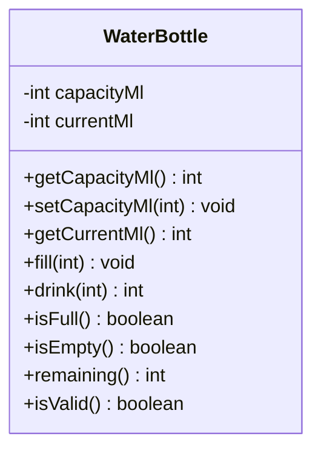

# Problem 18 — WaterBottle

**Level:** 4 | **Lab:** Class Blueprint

## Context

A reusable water bottle. Has a fixed capacity. Can be filled and drunk from. `drink()` returns how much was actually drunk — because asking for 500ml when only 200ml remain only gets you 200ml.

## UML



## Requirements

| Attribute | Type | Rule |
|---|---|---|
| capacityMl | int | `> 0` (start 1000) |
| currentMl | int | `0` to `capacityMl` (start 0, no setter) |

### Behaviour

- `setCapacityMl(value)` — if `value > 0`, sets capacity; if `currentMl > value`, caps `currentMl` to new capacity.
- `fill(ml)` — if `ml > 0`, `currentMl = Numbers.clamp(currentMl + ml, 0, capacityMl)`.
- `drink(ml)` — if `ml <= 0`, returns 0. Otherwise: `actual = min(ml, currentMl); currentMl -= actual; return actual`.
- `isFull()` — `currentMl == capacityMl`.
- `isEmpty()` — `currentMl == 0`.
- `remaining()` — `capacityMl - currentMl`.

## Sample interaction

```
Bottle: 1000ml capacity, currently 0ml
Fill: 600
Fill: 600 / 1000
Fill: 500
Fill: 1000 / 1000 (capped)
isFull? true
Drink: 300
Drink: got 300, now 700 / 1000
Drink: 1000
Drink: got 700, now 0 / 1000
isEmpty? true
```

## Chirp methods used

- [`Numbers.clamp(int, int, int)`](https://hyphensaad.github.io/chirp/javadoc/chirp/number/Numbers.html#clamp(int,int,int))
- [`Check.inRange(int, int, int)`](https://hyphensaad.github.io/chirp/javadoc/chirp/text/Check.html#inRange(int,int,int))
- [`Chirp.readInt(prompt, min, max)`](https://hyphensaad.github.io/chirp/javadoc/chirp/Chirp.html#readInt(java.lang.String,int,int))

## Tests to pass

- `freshBottleIsValid`
- `startsEmpty`
- `fillIncreasesCurrent`
- `fillCapsAtCapacity`
- `drinkReducesCurrent`
- `drinkReturnsActualAmountDrunk`
- `drinkWhenEmptyReturnsZero`
- `invalidFillRejected`
- `setCapacityBelowCurrentCapsCurrent`

## Files

`starter/` · `solution/` · `tests/`
