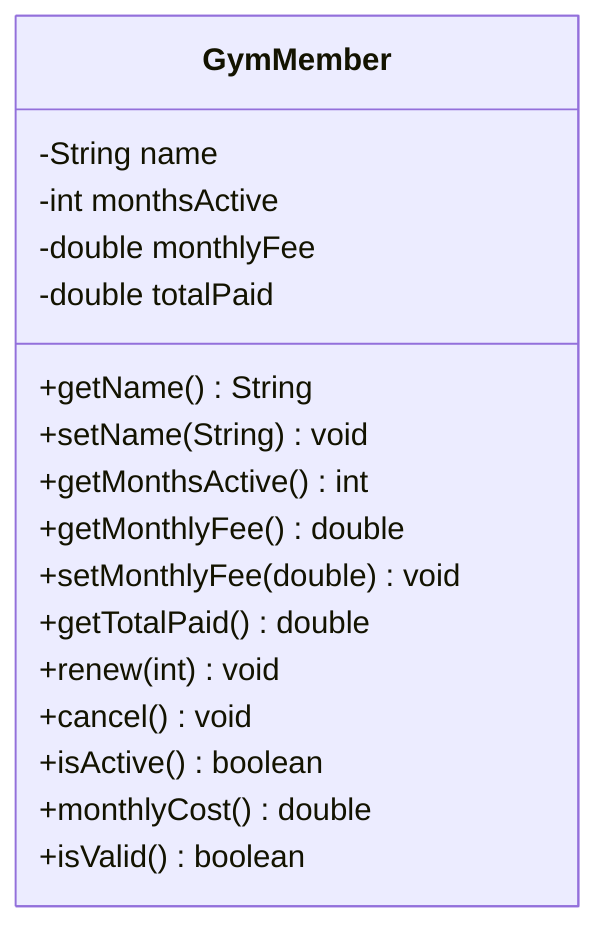

# Problem 19 — GymMember

**Level:** 4 | **Lab:** Class Blueprint

## Context

A gym tracks its members. Members renew for N months, and each renewal adds to their total paid. Cancelling stops future renewals but does not refund past payments.

## UML



## Requirements

| Attribute | Type | Rule |
|---|---|---|
| name | String | `Check.isName(value)` |
| monthsActive | int | `>= 0` (start 0, no setter) |
| monthlyFee | double | `> 0` |
| totalPaid | double | `>= 0` (start 0, no setter) |

### Behaviour

- `renew(months)` — if `months > 0`, adds `months` to `monthsActive` and `months * monthlyFee` to `totalPaid`. Invalid amounts silently rejected.
- `cancel()` — sets `monthsActive = 0`. `totalPaid` unchanged (money already paid is not refunded).
- `isActive()` — `monthsActive > 0`
- `monthlyCost()` — `totalPaid / monthsActive` if active, else `0`.

## Sample interaction

```
Member name: Bilal
Monthly fee: 1500

Member: Bilal
Months active: 0, total paid: Rs.0.00

Renew months: 3
After renew: 3 months, total paid: Rs.4500.00
isActive? true
monthlyCost: Rs.1500.00

Renew months: 2
After renew: 5 months, total paid: Rs.7500.00

Cancel
After cancel: 0 months, total paid: Rs.7500.00 (unchanged)
isActive? false
monthlyCost: Rs.0.00
```

## Chirp methods used

- [`Check.isName(String)`](https://hyphensaad.github.io/chirp/javadoc/chirp/text/Check.html#isName(java.lang.String))
- [`Check.inRange(double, double, double)`](https://hyphensaad.github.io/chirp/javadoc/chirp/text/Check.html#inRange(double,double,double))
- [`Chirp.readNonEmpty(prompt)`](https://hyphensaad.github.io/chirp/javadoc/chirp/Chirp.html#readNonEmpty(java.lang.String))
- [`Chirp.readDouble(prompt, min, max)`](https://hyphensaad.github.io/chirp/javadoc/chirp/Chirp.html#readDouble(java.lang.String,double,double))
- [`Chirp.readInt(prompt, min, max)`](https://hyphensaad.github.io/chirp/javadoc/chirp/Chirp.html#readInt(java.lang.String,int,int))
- [`Chirp.rupees(amount)`](https://hyphensaad.github.io/chirp/javadoc/chirp/Chirp.html#rupees(double))

## Tests to pass

- `validMemberReportsIsValid`
- `startsInactive`
- `renewIncreasesMonthsAndTotalPaid`
- `renewZeroOrNegativeRejected`
- `cancelSetsMonthsActiveToZero`
- `cancelKeepsTotalPaid`
- `monthlyCostWhenActive`
- `monthlyCostWhenInactiveIsZero`
- `zeroMonthlyFeeRejected`

## Files

`starter/` · `solution/` · `tests/`
