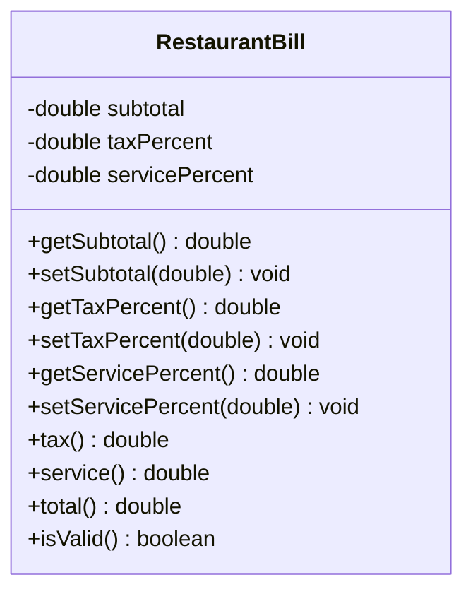

# Problem 20 — RestaurantBill

**Level:** 4 | **Lab:** Class Blueprint

## Context

A restaurant prints a bill for one table. The bill has a subtotal, a tax percentage, and a service charge percentage.

## UML



## Requirements

| Attribute | Type | Rule |
|---|---|---|
| subtotal | double | `>= 0` |
| taxPercent | double | `0` to `30` |
| servicePercent | double | `0` to `20` |

### Behaviour

- `tax()` = `subtotal * taxPercent / 100`
- `service()` = `subtotal * servicePercent / 100`
- `total()` = `subtotal + tax() + service()`

**Business rule:** tax and service are both computed on the **subtotal**, not compounded. This is a design choice — some regions compound service into tax. Pick one; document it in a comment in your code.

## Sample interaction

```
Subtotal: 2000
Tax %: 5
Service %: 10

Bill — subtotal Rs.2,000.00
Tax:     Rs.100.00
Service: Rs.200.00
Total:   Rs.2,300.00
```

## Chirp methods used

- [`Check.inRange(double, double, double)`](https://hyphensaad.github.io/chirp/chirp/text/Check.html#inRange(double,double,double))
- [`Chirp.readDouble(prompt, min, max)`](https://hyphensaad.github.io/chirp/chirp/Chirp.html#readDouble(java.lang.String,double,double))
- [`Chirp.rupees(amount)`](https://hyphensaad.github.io/chirp/chirp/Chirp.html#rupees(double))
- [`Chirp.percent(value, places)`](https://hyphensaad.github.io/chirp/chirp/Chirp.html#percent(double,int))

## Tests to pass

- `validBillReportsIsValid`
- `taxCalculatesOnSubtotal` — 2000 × 5% = 100
- `serviceCalculatesOnSubtotal` — 2000 × 10% = 200
- `totalAddsAllThree` — 2000 + 100 + 200 = 2300
- `taxAboveThirtyRejected`
- `serviceAboveTwentyRejected`
- `negativeSubtotalRejected`
- `zeroSubtotalYieldsZeroTotal`

## Files

`starter/` · `solution/` · `tests/`
