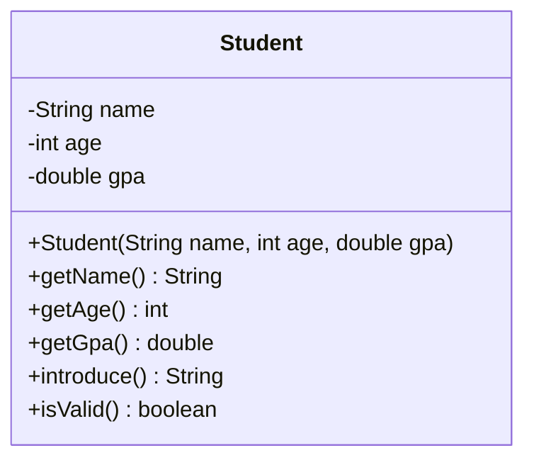

# Problem 1 — Student

**Level:** 1 | **Lab:** Object Creation

## Context

Take the `Student` class from Lab 1 and rewrite it so a `Student` can *only* be created with valid data. No `new Student()`, no setters — just `new Student(name, age, gpa)`.

## UML



## Requirements

### Constructor

```java
public Student(String name, int age, double gpa)
```

Validates each argument with `Check`:

| Argument | Type | Validation method | Rule |
|---|---|---|---|
| name | String | `Check.isName(name)` | Valid person name |
| age | int | `Check.inRange(age, 1, 120)` | 1 to 120 |
| gpa | double | `Check.inRange(gpa, 0.0, 4.0)` | 0.0 to 4.0 |

If any argument is invalid, that field stays at its Java default (`null` for `String`, `0` for `int`, `0.0` for `double`).

### Fields

All private, no setters. Getters only.

### Behaviour

- `introduce()` — `"Hi, I'm {name}. I'm {age} years old with a GPA of {gpa}."` (null name → `"?"`)
- `isValid()` — true only when all three fields are in range.

## Sample interaction

```
Name: John
Age: 20
GPA: 3.75

Hi, I'm John. I'm 20 years old with a GPA of 3.75.
Valid: true
⚠ Constructed with bad data — isValid? false
```

## Chirp methods used

- [`Check.isName(String)`](https://hyphensaad.github.io/chirp/javadoc/chirp/text/Check.html#isName(java.lang.String))
- [`Check.inRange(int, int, int)`](https://hyphensaad.github.io/chirp/javadoc/chirp/text/Check.html#inRange(int,int,int))
- [`Check.inRange(double, double, double)`](https://hyphensaad.github.io/chirp/javadoc/chirp/text/Check.html#inRange(double,double,double))
- [`Chirp.readNonEmpty(prompt)`](https://hyphensaad.github.io/chirp/javadoc/chirp/Chirp.html#readNonEmpty(java.lang.String))
- [`Chirp.readInt(prompt, min, max)`](https://hyphensaad.github.io/chirp/javadoc/chirp/Chirp.html#readInt(java.lang.String,int,int))
- [`Chirp.readDouble(prompt, min, max)`](https://hyphensaad.github.io/chirp/javadoc/chirp/Chirp.html#readDouble(java.lang.String,double,double))

## Tests to pass

- `constructorStoresValidValues` — valid construction, correct getters
- `invalidNameLeavesFieldNull` — empty name → `getName()` returns null
- `invalidAgeLeavesFieldZero` — age 200 → `getAge()` returns 0
- `invalidGpaLeavesFieldZero` — gpa -1 → `getGpa()` returns 0.0
- `isValidTrueForValidStudent`
- `isValidFalseForAnyInvalidField`
- `introduceIncludesAllFields`
- `introduceHandlesNullName`

## Files

`starter/` · `solution/` · `tests/`
