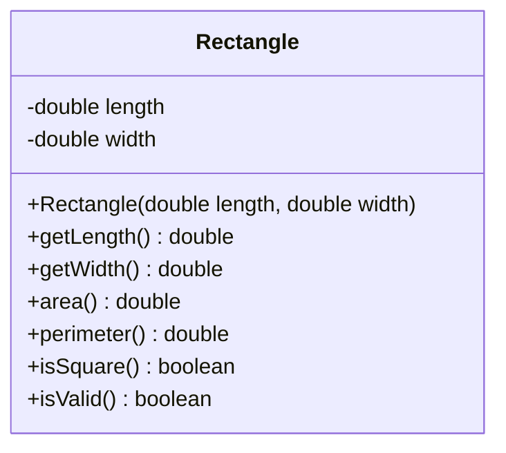

# Problem 2 — Rectangle

**Level:** 1 | **Lab:** Object Creation

## Context

A rectangle must have a length and a width. There is no such thing as a "blank rectangle" — so the class provides no default constructor.

## UML



## Requirements

### Constructor

```java
public Rectangle(double length, double width)
```

| Argument | Type | Rule |
|---|---|---|
| length | double | `> 0` |
| width | double | `> 0` |

Invalid values leave the field at `0.0`.

### Behaviour

- `area()` = `length * width`
- `perimeter()` = `2 * (length + width)`
- `isSquare()` = `length == width`

## Sample interaction

```
Length: 8
Width: 5

Area: 40.00
Perimeter: 26.00
Is square: false
⚠ Constructed with bad data — isValid? false
```

## Chirp methods used

- [`Check.inRange(double, double, double)`](https://hyphensaad.github.io/chirp/javadoc/chirp/text/Check.html#inRange(double,double,double))
- [`Chirp.readDouble(prompt, min, max)`](https://hyphensaad.github.io/chirp/javadoc/chirp/Chirp.html#readDouble(java.lang.String,double,double))
- [`Chirp.decimal(value, places)`](https://hyphensaad.github.io/chirp/javadoc/chirp/Chirp.html#decimal(double,int))

## Tests to pass

- `constructorStoresValidValues`
- `invalidLengthLeavesFieldZero`
- `invalidWidthLeavesFieldZero`
- `areaAndPerimeterCorrect`
- `isSquareWhenLengthEqualsWidth`
- `isValidFalseWhenAnyFieldZero`

## Files

`starter/` · `solution/` · `tests/`
