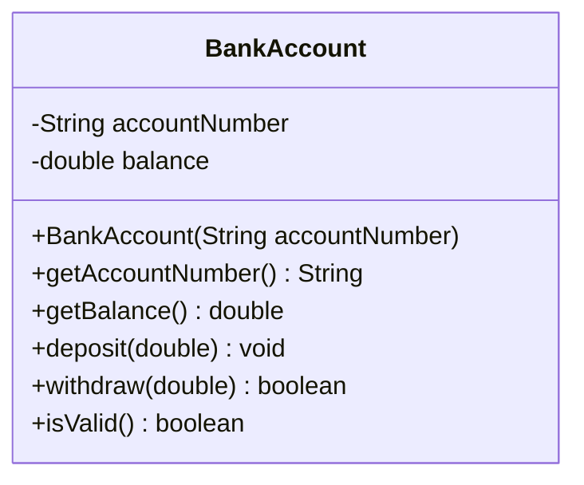

# Problem 3 — BankAccount

**Level:** 1 | **Lab:** Object Creation

## Context

A bank account has an account number that never changes, and a balance that starts at 0 and changes only through `deposit` / `withdraw`.

## UML



## Requirements

### Constructor

```java
public BankAccount(String accountNumber)
```

| Argument | Type | Rule |
|---|---|---|
| accountNumber | String | `Check.notBlank` |

`balance` is not a constructor argument — it always starts at `0.0`.

### Behaviour

- `deposit(amount)` — if `amount > 0`, adds to balance.
- `withdraw(amount)` — if `0 < amount <= balance`, reduces balance, returns `true`. Otherwise `false`.
- No setter for `accountNumber` or `balance`.

## Sample interaction

```
Account number: ACC-1001

Account: ACC-1001, balance Rs.0.00
Deposit: 500
Balance: Rs.500.00
Withdraw: 200
Withdraw: accepted — balance Rs.300.00
⚠ Constructed with bad data — isValid? false
```

## Chirp methods used

- [`Check.notBlank(String)`](https://hyphensaad.github.io/chirp/javadoc/chirp/text/Check.html#notBlank(java.lang.String))
- [`Chirp.readNonEmpty(prompt)`](https://hyphensaad.github.io/chirp/javadoc/chirp/Chirp.html#readNonEmpty(java.lang.String))
- [`Chirp.readDouble(prompt, min, max)`](https://hyphensaad.github.io/chirp/javadoc/chirp/Chirp.html#readDouble(java.lang.String,double,double))
- [`Chirp.rupees(amount)`](https://hyphensaad.github.io/chirp/javadoc/chirp/Chirp.html#rupees(double))

## Tests to pass

- `constructorStoresAccountNumber`
- `balanceStartsAtZero`
- `invalidAccountNumberLeavesFieldNull`
- `depositIncreasesBalance`
- `withdrawReducesBalanceAndReturnsTrue`
- `overWithdrawReturnsFalseAndKeepsBalance`
- `invalidAccountIsNotValid`

## Files

`starter/` · `solution/` · `tests/`
