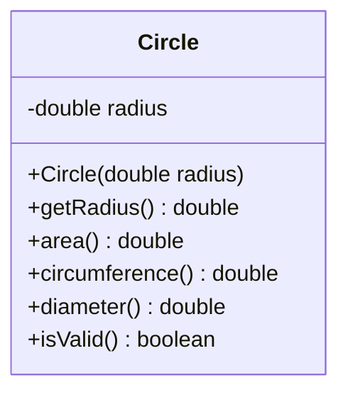

# Problem 4 — Circle

**Level:** 1 | **Lab:** Object Creation

## Context

A circle has one field: its radius. Which makes the parameterized-constructor story extremely clear — a circle without a radius isn't a circle.

## UML



## Requirements

### Constructor

```java
public Circle(double radius)
```

| Argument | Type | Rule |
|---|---|---|
| radius | double | `> 0` |

Invalid radius leaves the field at `0.0`.

### Behaviour

- `area()` = `Math.PI * radius * radius`
- `circumference()` = `2 * Math.PI * radius`
- `diameter()` = `2 * radius`

## Sample interaction

```
Radius: 5

Diameter: 10.00
Area: 78.54
Circumference: 31.42
⚠ Constructed with bad data — isValid? false
```

## Chirp methods used

- [`Check.inRange(double, double, double)`](https://hyphensaad.github.io/chirp/javadoc/chirp/text/Check.html#inRange(double,double,double))
- [`Chirp.readDouble(prompt, min, max)`](https://hyphensaad.github.io/chirp/javadoc/chirp/Chirp.html#readDouble(java.lang.String,double,double))
- [`Chirp.decimal(value, places)`](https://hyphensaad.github.io/chirp/javadoc/chirp/Chirp.html#decimal(double,int))

## Tests to pass

- `constructorStoresRadius`
- `invalidRadiusLeavesFieldZero`
- `areaCircumfrenceDiameterCorrect`
- `isValidFalseForZeroRadius`
- `isValidTrueForPositiveRadius`

## Files

`starter/` · `solution/` · `tests/`
