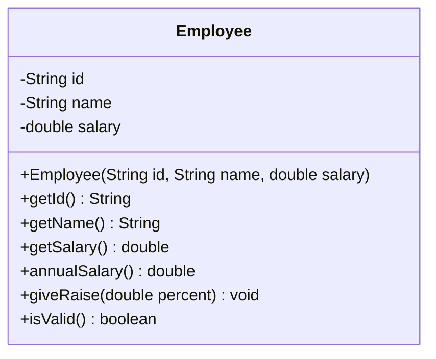

# Problem 5 — Employee

**Level:** 1 | **Lab:** Object Creation

## Context

An employee has an ID, a name, and a monthly salary. The salary mutates via `giveRaise` — the constructor sets the starting salary. Everything else is read-only after creation.

## UML



## Requirements

### Constructor

```java
public Employee(String id, String name, double salary)
```

| Argument | Type | Rule |
|---|---|---|
| id | String | `Check.notBlank` |
| name | String | `Check.isName` |
| salary | double | `> 0` |

### Behaviour

- `annualSalary()` = `salary * 12`
- `giveRaise(percent)` — if `Check.inRange(percent, 0, 100)`, increases salary by `percent`%. Invalid values silently ignored.

## Sample interaction

```
Employee ID: EMP-101
Name: Ali
Monthly salary: 50000

Employee: Ali (EMP-101)
Monthly: Rs.50,000.00
Annual: Rs.600,000.00
Raise %: 10
After 10.0% raise: Rs.55,000.00
⚠ Constructed with bad data — isValid? false
```

## Chirp methods used

- [`Check.isName(String)`](https://hyphensaad.github.io/chirp/javadoc/chirp/text/Check.html#isName(java.lang.String))
- [`Check.notBlank(String)`](https://hyphensaad.github.io/chirp/javadoc/chirp/text/Check.html#notBlank(java.lang.String))
- [`Check.inRange(double, double, double)`](https://hyphensaad.github.io/chirp/javadoc/chirp/text/Check.html#inRange(double,double,double))
- [`Chirp.readNonEmpty(prompt)`](https://hyphensaad.github.io/chirp/javadoc/chirp/Chirp.html#readNonEmpty(java.lang.String))
- [`Chirp.readDouble(prompt, min, max)`](https://hyphensaad.github.io/chirp/javadoc/chirp/Chirp.html#readDouble(java.lang.String,double,double))
- [`Chirp.rupees(amount)`](https://hyphensaad.github.io/chirp/javadoc/chirp/Chirp.html#rupees(double))

## Tests to pass

- `constructorStoresValidValues`
- `invalidSalaryLeavesFieldZero`
- `annualSalaryIsMonthlyTimesTwelve`
- `giveRaiseIncreasesSalary`
- `giveRaiseOutOfRangeIgnored`
- `isValidFalseForZeroSalary`

## Files

`starter/` · `solution/` · `tests/`
