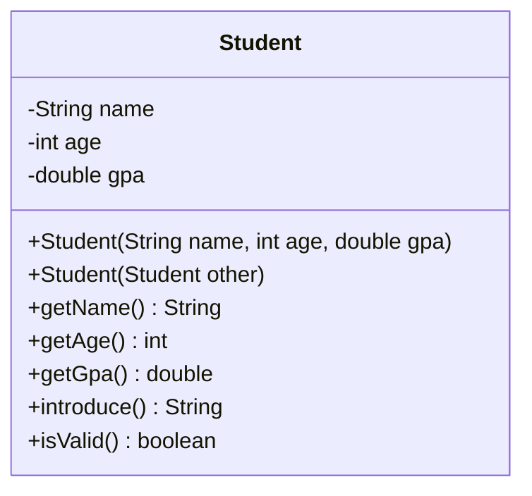

# Problem 1 — Student (Copy Constructor)

**Level:** 2 | **Lab:** Object Creation

## Context

A `Student` from the previous level — but now you can duplicate it. Given an existing `Student`, produce a new one with the same name, age, and GPA.

## UML



## Requirements

### Constructors

| Constructor | Purpose |
|---|---|
| `Student(String name, int age, double gpa)` | Primary — from raw data |
| `Student(Student other)` | Copy — from an existing Student |

### Copy constructor rules

- If `other` is `null`, leave all fields at defaults.
- Otherwise, copy all three fields directly: `this.name = other.name;`, `this.age = other.age;`, `this.gpa = other.gpa;`
- No `Check` validation in the copy constructor — the source object is already validated (or was rejected when it was constructed).

## Sample interaction

```
Name: John
Age: 20
GPA: 3.75

Original: Hi, I'm John. I'm 20 years old with a GPA of 3.75.

Copy created from original.
Copy:     Hi, I'm John. I'm 20 years old with a GPA of 3.75.

Both report identical values — the copy is a snapshot.
```

## Chirp methods used

- [`Check.isName(String)`](http://hyphensaad.github.io/chirp/javadoc/chirp/text/Check.html#isName(java.lang.String))
- [`Check.inRange(int, int, int)`](http://hyphensaad.github.io/chirp/javadoc/chirp/text/Check.html#inRange(int,int,int))
- [`Check.inRange(double, double, double)`](http://hyphensaad.github.io/chirp/javadoc/chirp/text/Check.html#inRange(double,double,double))
- [`Chirp.readNonEmpty(prompt)`](http://hyphensaad.github.io/chirp/javadoc/chirp/Chirp.html#readNonEmpty(java.lang.String))
- [`Chirp.readInt(prompt, min, max)`](http://hyphensaad.github.io/chirp/javadoc/chirp/Chirp.html#readInt(java.lang.String,int,int))
- [`Chirp.readDouble(prompt, min, max)`](http://hyphensaad.github.io/chirp/javadoc/chirp/Chirp.html#readDouble(java.lang.String,double,double))

## Tests to pass

- `copyConstructorCopiesAllFields`
- `copyOfValidIsValid`
- `copyOfInvalidIsInvalid`
- `copyOfNullHasDefaults`
- `originalUnaffectedByCopyCreation` — no aliasing possible on scalars

## Files

`starter/` · `solution/` · `tests/`
