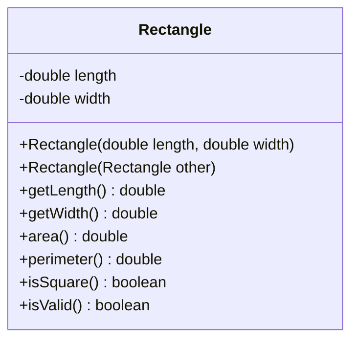

# Problem 2 — Rectangle (Copy Constructor)

**Level:** 2 | **Lab:** Object Creation

## Context

Reinforce the copy-constructor pattern with a `Rectangle`. Two scalar fields, so the copy is trivially independent.

## UML



## Requirements

### Constructors

| Constructor | Purpose |
|---|---|
| `Rectangle(double length, double width)` | Primary |
| `Rectangle(Rectangle other)` | Copy — same length, same width |

If `other` is `null`, fields stay at `0.0` (and `isValid()` returns `false`).

## Sample interaction

```
Length: 8
Width: 5

Original: 8.00 x 5.00 — area 40.00
Copy:     8.00 x 5.00 — area 40.00

Both isValid: true
```

## Chirp methods used

- [`Check.inRange(double, double, double)`](http://hyphensaad.github.io/chirp/javadoc/chirp/text/Check.html#inRange(double,double,double))
- [`Chirp.readDouble(prompt, min, max)`](http://hyphensaad.github.io/chirp/javadoc/chirp/Chirp.html#readDouble(java.lang.String,double,double))
- [`Chirp.decimal(value, places)`](http://hyphensaad.github.io/chirp/javadoc/chirp/Chirp.html#decimal(double,int))

## Tests to pass

- `copyConstructorCopiesFields`
- `copyOfValidIsValid`
- `copyOfNullHasDefaults`
- `copyPreservesAreaAndPerimeter`

## Files

`starter/` · `solution/` · `tests/`
