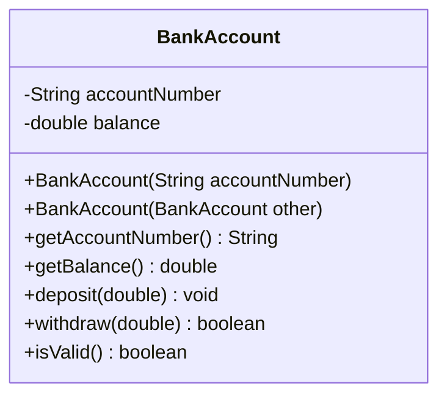

# Problem 3 — BankAccount (Copy Constructor)

**Level:** 2 | **Lab:** Object Creation

## Context

Now the copy must be truly **independent**. Deposit money into the copy — the original's balance must not change. This is the first problem where copy-constructor correctness is observable.

## UML



## Requirements

### Constructors

| Constructor | Purpose |
|---|---|
| `BankAccount(String accountNumber)` | Primary — balance starts at 0 |
| `BankAccount(BankAccount other)` | Copy — same account number, same balance |

If `other` is `null`, fields stay at defaults.

## The independence test

This problem's demo runs the crucial test:

```java
BankAccount original = new BankAccount("ACC-1001");
original.deposit(500);                    // balance = 500
BankAccount copy = new BankAccount(original);  // copy also 500

original.deposit(300);                    // original now 800
// copy MUST still be 500 — not 800, not 0
```

If the copy is 800, the copy constructor accidentally shared state. If the copy is 0, the constructor forgot to copy the balance.

## Sample interaction

```
Account number: ACC-1001

Created original.
Original balance: Rs.0.00
Deposit 500 to original...
Original balance: Rs.500.00

Copy created from original.
Copy balance: Rs.500.00

Deposit 300 to original...
Original balance: Rs.800.00
Copy balance: Rs.500.00   <-- independent!
```

## Chirp methods used

- [`Check.notBlank(String)`](http://hyphensaad.github.io/chirp/javadoc/chirp/text/Check.html#notBlank(java.lang.String))
- [`Chirp.readNonEmpty(prompt)`](http://hyphensaad.github.io/chirp/javadoc/chirp/Chirp.html#readNonEmpty(java.lang.String))
- [`Chirp.readDouble(prompt, min, max)`](http://hyphensaad.github.io/chirp/javadoc/chirp/Chirp.html#readDouble(java.lang.String,double,double))
- [`Chirp.rupees(amount)`](http://hyphensaad.github.io/chirp/javadoc/chirp/Chirp.html#rupees(double))

## Tests to pass

- `copyConstructorCopiesAccountNumberAndBalance`
- `copyOfNullHasDefaults`
- `depositToOriginalDoesNotAffectCopy`
- `depositToCopyDoesNotAffectOriginal`
- `withdrawFromCopyDoesNotAffectOriginal`
- `copyOfInvalidIsInvalid`

## Files

`starter/` · `solution/` · `tests/`
