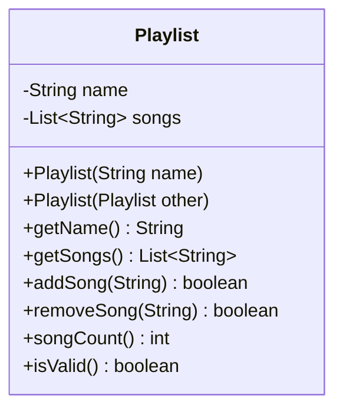

# Problem 4 — Playlist (Deep Copy)

**Level:** 2 | **Lab:** Object Creation

## Context

A playlist has a name and a **list of songs**. Copying the reference to the list would make the two playlists share their contents. This problem teaches the **shallow vs. deep copy** distinction.

## UML



## Requirements

### Constructors

| Constructor | Purpose |
|---|---|
| `Playlist(String name)` | Primary — starts with empty song list |
| `Playlist(Playlist other)` | Copy — **deep copy** the song list |

### Copy constructor — the key line

```java
// WRONG — shallow copy, both lists are the same object
this.songs = other.songs;

// RIGHT — deep copy, independent list with same contents
this.songs = new ArrayList<>(other.songs);
```

If `other` is `null` — leave fields at defaults (name `null`, empty list).

### Behaviour

- `addSong(title)` — returns `true` if added (non-blank, not already present), `false` otherwise.
- `removeSong(title)` — returns `true` if removed, `false` otherwise.
- `songCount()` — size of list.
- `getSongs()` — returns `List.copyOf(songs)` so callers can't mutate the internal list.

## Sample interaction

```
Playlist name: Workout Mix

Created original.
Added: Eye of the Tiger
Added: Stronger
Original songs (2): Eye of the Tiger, Stronger

Copy created from original.
Copy songs (2): Eye of the Tiger, Stronger

Add 'Believer' to original...
Original songs (3): Eye of the Tiger, Stronger, Believer
Copy songs (2): Eye of the Tiger, Stronger   <-- independent!
```

## Chirp methods used

- [`Check.notBlank(String)`](http://hyphensaad.github.io/chirp/javadoc/chirp/text/Check.html#notBlank(java.lang.String))
- [`Chirp.readNonEmpty(prompt)`](http://hyphensaad.github.io/chirp/javadoc/chirp/Chirp.html#readNonEmpty(java.lang.String))
- [`Text.join(delimiter, parts...)`](http://hyphensaad.github.io/chirp/javadoc/chirp/text/Text.html#join(java.lang.String,java.lang.Object...))

## Tests to pass

- `copyConstructorCopiesName`
- `copyConstructorHasSameSongs`
- `copyConstructorDeepCopiesList` — add to original, verify copy unchanged
- `addSongToCopyDoesNotAffectOriginal`
- `getSongsReturnsImmutableCopy`
- `copyOfNullHasDefaults`

## Files

`starter/` · `solution/` · `tests/`
