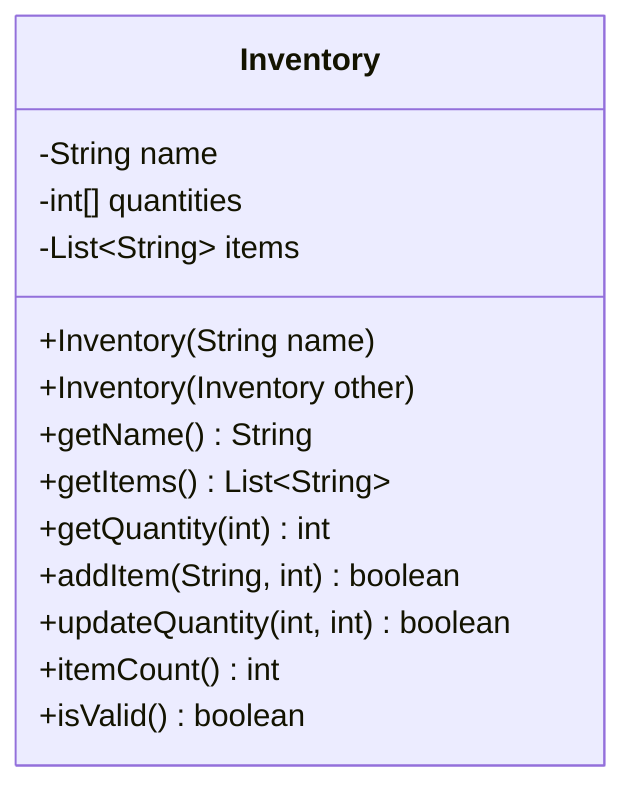

# Problem 5 — Inventory (Deep Copy of Array + List)

**Level:** 2 | **Lab:** Object Creation

## Context

The final copy-constructor problem. An `Inventory` holds **two mutable data structures** — an `int[]` array of quantities and a `List<String>` of item names. Both must be deep-copied.

## UML



## Requirements

### Constructors

| Constructor | Purpose |
|---|---|
| `Inventory(String name)` | Primary — empty items, empty quantities |
| `Inventory(Inventory other)` | Copy — **deep copy both** array and list |

### Copy constructor — the two key lines

```java
this.quantities = other.quantities.clone();       // array deep copy
this.items = new ArrayList<>(other.items);        // list deep copy
```

Both are needed. Missing either one leaves a shared reference.

### Behaviour

- `addItem(name, quantity)` — adds to both lists. Returns `false` if name is blank, quantity `< 0`, or name already exists.
- `updateQuantity(index, newQty)` — changes the quantity at `index`. Returns `false` if index out of bounds or newQty `< 0`.
- `getQuantity(index)` — returns the quantity at `index`, or `-1` if out of bounds.
- `getItems()` — returns an unmodifiable view of the item list.
- `itemCount()` — size of the item list.

## Sample interaction

```
Inventory name: Warehouse A

Created original.
Added Pen (100)
Added Notebook (50)
Original items: [Pen=100, Notebook=50]

Copy created from original.
Copy items:     [Pen=100, Notebook=50]

Update original item 0 to 200...
Original item 0: 200
Copy item 0:     100   <-- array was deep-copied!

Add Eraser to original...
Original items: 3
Copy items:     2   <-- list was deep-copied!
```

## Chirp methods used

- [`Check.notBlank(String)`](http://hyphensaad.github.io/chirp/javadoc/chirp/text/Check.html#notBlank(java.lang.String))
- [`Check.inRange(int, int, int)`](http://hyphensaad.github.io/chirp/javadoc/chirp/text/Check.html#inRange(int,int,int))
- [`Chirp.readNonEmpty(prompt)`](http://hyphensaad.github.io/chirp/javadoc/chirp/Chirp.html#readNonEmpty(java.lang.String))
- [`Chirp.readInt(prompt, min, max)`](http://hyphensaad.github.io/chirp/javadoc/chirp/Chirp.html#readInt(java.lang.String,int,int))

## Tests to pass

- `copyConstructorCopiesName`
- `copyConstructorHasSameItemCount`
- `arrayDeepCopy` — mutate quantity in original, verify copy unchanged
- `listDeepCopy` — add item to original, verify copy unchanged
- `copyOfNullHasDefaults`
- `getItemsReturnsUnmodifiableList`

## Files

`starter/` · `solution/` · `tests/`
