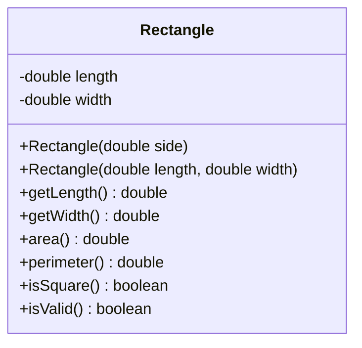

# Problem 1 — Rectangle (Square vs Rectangle)

**Level:** 3 | **Lab:** Object Creation

## Context

Most real rectangles come in two shapes: squares (one side length) and general rectangles (two side lengths). Instead of forcing the caller to write `new Rectangle(5, 5)` for a square, provide a second constructor `new Rectangle(5)` that means the same thing.

## UML



## Requirements

### Two constructors

| Constructor | Meaning |
|---|---|
| `Rectangle(double side)` | A square — both length and width are `side` |
| `Rectangle(double length, double width)` | A general rectangle |

Both constructors validate every argument with `Check.inRange(value, 0.0001, Double.MAX_VALUE)`. Invalid values leave fields at `0.0`.

### Behaviour

- `area()` = `length * width`
- `perimeter()` = `2 * (length + width)`
- `isSquare()` = `length == width`
- Both constructors produce a square when the arguments are equal, so `new Rectangle(5).isSquare()` is `true` and `new Rectangle(5, 5).isSquare()` is also `true`.

## Sample interaction

```
--- Create a square ---
Side: 5
Square: 5.00 x 5.00 — area 25.00, isSquare true

--- Create a general rectangle ---
Length: 8
Width: 5
Rectangle: 8.00 x 5.00 — area 40.00, isSquare false
```

## Chirp methods used

- [`Check.inRange(double, double, double)`](http://hyphensaad.github.io/chirp/javadoc/chirp/text/Check.html#inRange(double,double,double))
- [`Chirp.readDouble(prompt, min, max)`](http://hyphensaad.github.io/chirp/javadoc/chirp/Chirp.html#readDouble(java.lang.String,double,double))
- [`Chirp.decimal(value, places)`](http://hyphensaad.github.io/chirp/javadoc/chirp/Chirp.html#decimal(double,int))

## Tests to pass

- `squareConstructorSetsBothSides` — `new Rectangle(5)` has length 5 and width 5
- `squareConstructorProducesValidSquare`
- `rectangleConstructorStoresBothSides`
- `rectangleConstructorOfSquareProducesSquare` — `new Rectangle(5, 5).isSquare()` is true
- `invalidSideLeavesBothZero`
- `invalidLengthOrWidthLeavesRespectiveFieldZero`

## Files

`starter/` · `solution/` · `tests/`
