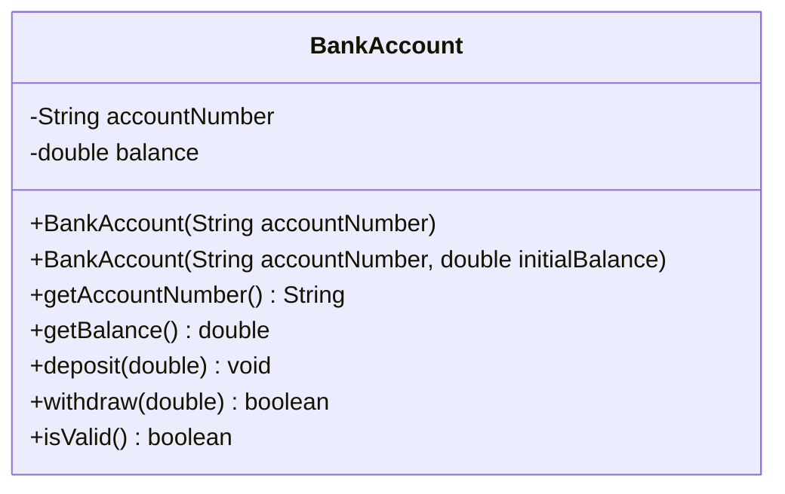

# Problem 2 — BankAccount (With or Without Initial Balance)

**Level:** 3 | **Lab:** Object Creation

## Context

Opening a bank account starts with a zero balance unless the customer deposits at the time of opening. Two constructors reflect that reality: one for the "account only" case, one for "account + initial deposit".

## UML



## Requirements

### Two constructors

| Constructor | Meaning |
|---|---|
| `BankAccount(String accountNumber)` | Open with balance `0.0` |
| `BankAccount(String accountNumber, double initialBalance)` | Open with the given starting balance |

Both validate `accountNumber` with `Check.notBlank`. The two-argument version also validates `initialBalance` with `Check.inRange(value, 0, Double.MAX_VALUE)`.

### Behaviour

- `deposit(amount)` — if `amount > 0`, adds to balance
- `withdraw(amount)` — if `0 < amount <= balance`, reduces balance, returns `true`; else `false`

## Sample interaction

```
--- Account without initial deposit ---
Account number: ACC-1001
Balance: Rs.0.00

--- Account with initial deposit ---
Account number: ACC-1002
Initial balance: 5000
Balance: Rs.5,000.00

Deposit 500 to ACC-1001...
ACC-1001 balance: Rs.500.00
ACC-1002 balance: Rs.5,000.00   <-- independent accounts
```

## Chirp methods used

- [`Check.notBlank(String)`](http://hyphensaad.github.io/chirp/javadoc/chirp/text/Check.html#notBlank(java.lang.String))
- [`Check.inRange(double, double, double)`](http://hyphensaad.github.io/chirp/javadoc/chirp/text/Check.html#inRange(double,double,double))
- [`Chirp.readNonEmpty(prompt)`](http://hyphensaad.github.io/chirp/javadoc/chirp/Chirp.html#readNonEmpty(java.lang.String))
- [`Chirp.readDouble(prompt, min, max)`](http://hyphensaad.github.io/chirp/javadoc/chirp/Chirp.html#readDouble(java.lang.String,double,double))
- [`Chirp.rupees(amount)`](http://hyphensaad.github.io/chirp/javadoc/chirp/Chirp.html#rupees(double))

## Tests to pass

- `singleArgConstructorStartsAtZero`
- `twoArgConstructorStoresInitialBalance`
- `invalidAccountNumberInEitherConstructorLeavesNull`
- `invalidInitialBalanceInTwoArgLeavesZero`
- `twoAccountsAreIndependent`
- `negativeInitialBalanceRejected`

## Files

`starter/` · `solution/` · `tests/`
