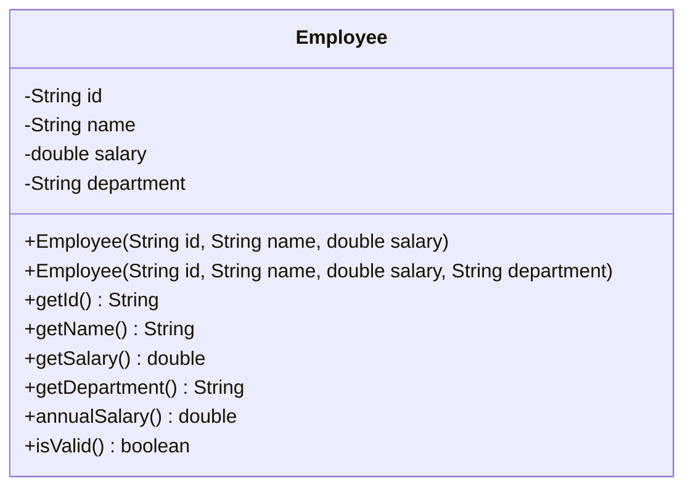

# Problem 3 — Employee (With or Without Department)

**Level:** 3 | **Lab:** Object Creation

## Context

Most employees start in a default department ("General") and get assigned later. Provide two constructors: one that uses the default, one that lets the caller specify.

## UML



## Requirements

### Two constructors

| Constructor | Department |
|---|---|
| `Employee(String id, String name, double salary)` | Defaults to `"General"` |
| `Employee(String id, String name, double salary, String department)` | Uses the provided department |

All constructors validate `id`, `name`, `salary` with the same rules from Lab 2. The four-argument version also validates `department` with `Check.notBlank`.

## Sample interaction

```
--- Employee without explicit department ---
ID: EMP-101
Name: John
Salary: 50000
Employee: John (EMP-101), dept=General, annual=Rs.600,000.00

--- Employee with explicit department ---
ID: EMP-102
Name: Sara
Salary: 70000
Department: Engineering
Employee: Sara (EMP-102), dept=Engineering, annual=Rs.840,000.00
```

## Chirp methods used

- [`Check.isName(String)`](http://hyphensaad.github.io/chirp/javadoc/chirp/text/Check.html#isName(java.lang.String))
- [`Check.notBlank(String)`](http://hyphensaad.github.io/chirp/javadoc/chirp/text/Check.html#notBlank(java.lang.String))
- [`Check.inRange(double, double, double)`](http://hyphensaad.github.io/chirp/javadoc/chirp/text/Check.html#inRange(double,double,double))
- [`Chirp.readNonEmpty(prompt)`](http://hyphensaad.github.io/chirp/javadoc/chirp/Chirp.html#readNonEmpty(java.lang.String))
- [`Chirp.readDouble(prompt, min, max)`](http://hyphensaad.github.io/chirp/javadoc/chirp/Chirp.html#readDouble(java.lang.String,double,double))
- [`Chirp.rupees(amount)`](http://hyphensaad.github.io/chirp/javadoc/chirp/Chirp.html#rupees(double))

## Tests to pass

- `threeArgUsesGeneralDepartment`
- `fourArgStoresProvidedDepartment`
- `fourArgRejectsBlankDepartment`
- `annualSalaryCorrectForBoth`
- `invalidBasicFieldsRejectedInBothConstructors`
- `threeArgEmployeeIsValid`

## Files

`starter/` · `solution/` · `tests/`
