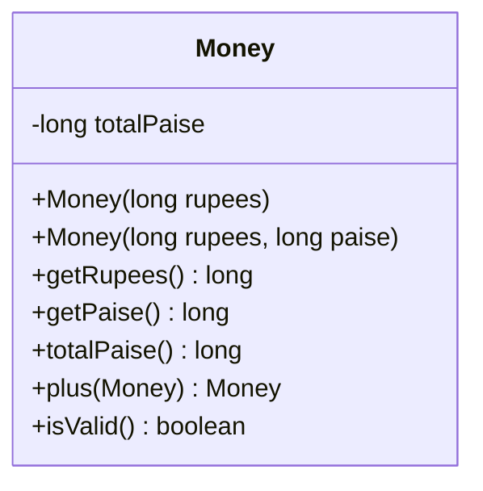

# Problem 4 — Money (Rupees, or Rupees + Paise)

**Level:** 3 | **Lab:** Object Creation

## Context

Most prices are whole rupees — but some are `Rs. 99.50`. Provide two constructors: `new Money(100)` means `Rs. 100.00`, `new Money(99, 50)` means `Rs. 99.50`. Same types, different arity.

Internally, money is stored as a single `long` of total paise (1 rupee = 100 paise). That avoids floating-point rounding errors that would plague a `double` field.

## UML



## Requirements

### Two constructors

| Constructor | Meaning |
|---|---|
| `Money(long rupees)` | `rupees * 100` paise |
| `Money(long rupees, long paise)` | `rupees * 100 + paise` paise |

Rules:
- Both constructors reject negative values by leaving `totalPaise = 0` (default).
- The two-argument version also rejects `paise >= 100` — the caller should use `new Money(101, 0)` instead of `new Money(100, 100)`.

### Behaviour

- `getRupees()` = `totalPaise / 100`
- `getPaise()` = `totalPaise % 100`
- `totalPaise()` = `totalPaise` (raw value for arithmetic)
- `plus(other)` — returns a new `Money` with the summed value
- `isValid()` — `totalPaise >= 0`

## Sample interaction

```
--- Whole rupees ---
Rupees: 100
Money: Rs.100.00  (total paise: 10000)

--- Rupees + paise ---
Rupees: 99
Paise: 50
Money: Rs.99.50  (total paise: 9950)

Sum of the two: Rs.199.50
```

## Chirp methods used

- [`Check.inRange(long, long, long)`](http://hyphensaad.github.io/chirp/javadoc/chirp/text/Check.html#inRange(long,long,long))
- [`Chirp.readLong(prompt, min, max)`](http://hyphensaad.github.io/chirp/javadoc/chirp/Chirp.html#readLong(java.lang.String,long,long))
- [`Chirp.fmt(template, kv)`](http://hyphensaad.github.io/chirp/javadoc/chirp/Chirp.html#fmt(java.lang.String,java.lang.Object...))

## Tests to pass

- `singleArgConstructorStoresRupeesTimes100Paise`
- `twoArgConstructorAddsRupeesAndPaise`
- `twoArgRejectsPaiseAbove99`
- `negativeRupeesLeavesZero`
- `plusReturnsNewIndependentMoney`
- `getRupeesAndGetPaiseDecomposeCorrectly`

## Files

`starter/` · `solution/` · `tests/`
