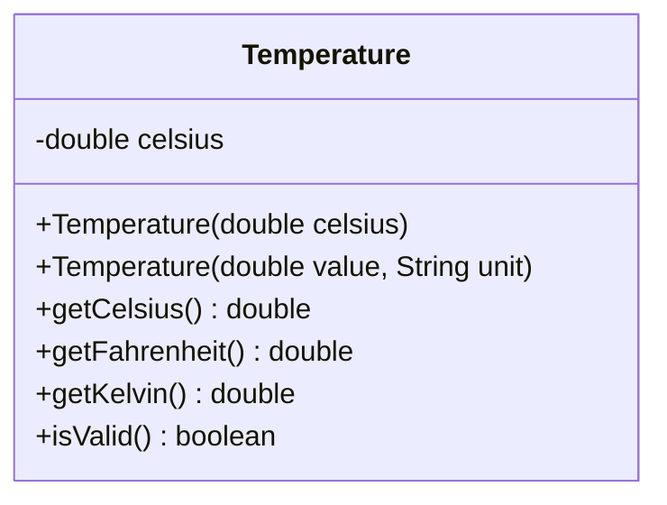

# Problem 5 — Temperature (Celsius by Default, Any Unit Explicitly)

**Level:** 3 | **Lab:** Object Creation

## Context

The most useful overload of the level. A `Temperature` internally stores Celsius — but the caller can construct it from Celsius, Fahrenheit, or Kelvin. The **unit argument changes the meaning of the value**.

This is overloading that isn't just about arity — it's about **semantic context**.

## UML



## Requirements

### Two constructors

| Constructor | Meaning |
|---|---|
| `Temperature(double celsius)` | Value interpreted as Celsius |
| `Temperature(double value, String unit)` | Value interpreted per `unit`: `"C"`, `"F"`, `"K"` |

### Unit handling

- `"C"` / `"Celsius"` — value stored as-is
- `"F"` / `"Fahrenheit"` — value converted: `(value - 32) * 5 / 9`
- `"K"` / `"Kelvin"` — value converted: `value - 273.15`
- Any other unit → leave `celsius = 0.0` (invalid input)

### Validation

Every constructor validates the **resulting Celsius value** against absolute zero (`>= -273.15`). Values below absolute zero leave `celsius = 0.0`.

### Behaviour

- `getCelsius()` — return stored Celsius
- `getFahrenheit()` = `celsius * 9/5 + 32`
- `getKelvin()` = `celsius + 273.15`

## Sample interaction

```
--- Celsius reading ---
Celsius: 25
Temperature: 25.00 C  (= 77.00 F, 298.15 K)

--- Fahrenheit reading ---
Fahrenheit: 212
Temperature: 100.00 C  (= 212.00 F, 373.15 K)
```

Both readings print the **same** object state (Celsius) — the unit argument only affects how the input was interpreted.

## Chirp methods used

- [`Check.inRange(double, double, double)`](http://hyphensaad.github.io/chirp/javadoc/chirp/text/Check.html#inRange(double,double,double))
- [`Chirp.readDouble(prompt, min, max)`](http://hyphensaad.github.io/chirp/javadoc/chirp/Chirp.html#readDouble(java.lang.String,double,double))
- [`Chirp.readNonEmpty(prompt)`](http://hyphensaad.github.io/chirp/javadoc/chirp/Chirp.html#readNonEmpty(java.lang.String))
- [`Chirp.decimal(value, places)`](http://hyphensaad.github.io/chirp/javadoc/chirp/Chirp.html#decimal(double,int))

## Tests to pass

- `celsiusConstructorStoresValue`
- `fahrenheitConstructorConverts`
- `kelvinConstructorConverts`
- `unitCaseAndLongNameAccepted` — `"C"` and `"Celsius"` work identically
- `belowAbsoluteZeroLeavesZero` — `-300°C` rejected
- `belowAbsoluteZeroFahrenheitRejected` — `-500°F` rejected (below -273.15°C)
- `unknownUnitLeavesZero`

## Files

`starter/` · `solution/` · `tests/`
