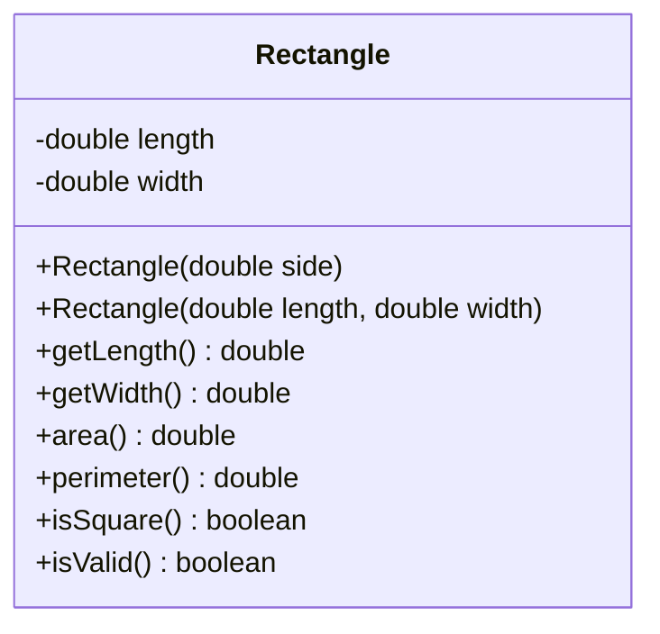

# Problem 1 — Rectangle (First `this(...)`)

**Level:** 4 | **Lab:** Object Creation

## Context

The Level 3 `Rectangle` had two constructors, each with its own validation. When you change the rules (say, "length must be at least 0.5" instead of "> 0"), you have to change it in both places. That's the duplication we're removing.

The fix: **one constructor does the work, the other delegates**.

## UML



## Requirements

### Two constructors — but only one does the work

| Constructor | Body |
|---|---|
| `Rectangle(double length, double width)` | **Canonical** — validates both, stores both |
| `Rectangle(double side)` | **Delegating** — `this(side, side);` as the first and only statement |

```java
public Rectangle(double side) {
    this(side, side);
}

public Rectangle(double length, double width) {
    if (Check.inRange(length, 0.0001, Double.MAX_VALUE)) this.length = length;
    if (Check.inRange(width, 0.0001, Double.MAX_VALUE)) this.width = width;
}
```

The square constructor has **zero** validation of its own. It just forwards. If the rules change tomorrow, they change in one place.

## The lesson

Compare the line counts:

| | Level 3 | Level 4 |
|---|---|---|
| Validation lines | 3 | 2 |
| Constructor bodies (excluding validation) | 4 | 2 |

The saving is small here because the class is small. In Problem 3 (`Employee`) you'll see a bigger gap — that's when `this(...)` really pays.

## Sample interaction

```
--- Square ---
Side: 5
5.00 x 5.00 — isSquare true

--- Rectangle ---
Length: 8
Width: 5
8.00 x 5.00 — isSquare false

Both isValid: true / true
```

## Chirp methods used

- [`Check.inRange(double, double, double)`](http://hyphensaad.github.io/chirp/javadoc/chirp/text/Check.html#inRange(double,double,double))
- [`Chirp.readDouble(prompt, min, max)`](http://hyphensaad.github.io/chirp/javadoc/chirp/Chirp.html#readDouble(java.lang.String,double,double))
- [`Chirp.decimal(value, places)`](http://hyphensaad.github.io/chirp/javadoc/chirp/Chirp.html#decimal(double,int))

## Tests to pass

- `squareConstructorDelegatesToRectangle` — `new Rectangle(5)` has length=5, width=5
- `rectangleConstructorValidatesIndependently`
- `invalidSideLeavesBothZero`
- `squareIsSquare`
- `rectangleConstructorOfSquareProducesSquare`
- `bothConstructorsUseSameValidationRange`

## Files

`starter/` · `solution/` · `tests/`
