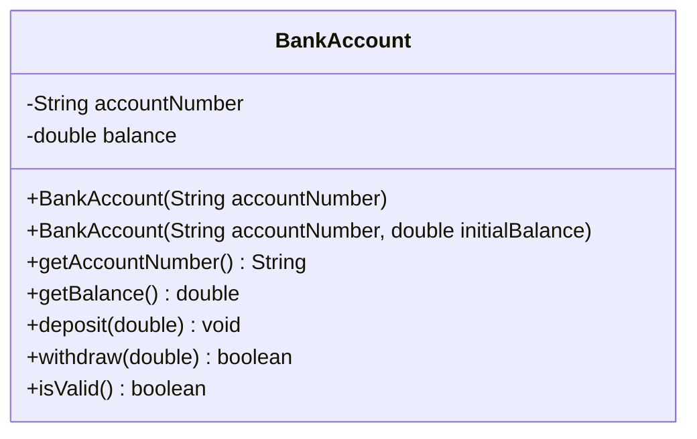

# Problem 2 — BankAccount (Chaining for Default Values)

**Level:** 4 | **Lab:** Object Creation

## Context

The single-argument `BankAccount(String accountNumber)` from Level 3 duplicated the `Check.notBlank(accountNumber)` line. The fix is clean: it means "open with zero balance", so it should delegate to the two-arg constructor with `0`.

## UML



## Requirements

### Two constructors — one canonical

| Constructor | Body |
|---|---|
| `BankAccount(String accountNumber, double initialBalance)` | **Canonical** — validates both arguments |
| `BankAccount(String accountNumber)` | **Delegating** — `this(accountNumber, 0.0);` |

```java
public BankAccount(String accountNumber) {
    this(accountNumber, 0.0);
}

public BankAccount(String accountNumber, double initialBalance) {
    if (Check.notBlank(accountNumber)) this.accountNumber = accountNumber;
    if (Check.inRange(initialBalance, 0, Double.MAX_VALUE)) this.balance = initialBalance;
}
```

## The lesson

The one-argument constructor now has **zero** validation logic. When you later add a rule to `initialBalance` — say "must be a multiple of 100" — it applies to both constructors automatically, because both go through the same canonical path.

## Sample interaction

```
--- Open without deposit ---
Account number: ACC-1001
Balance: Rs.0.00

--- Open with deposit ---
Account number: ACC-1002
Initial balance: 5000
Balance: Rs.5,000.00
```

## Chirp methods used

- [`Check.notBlank(String)`](http://hyphensaad.github.io/chirp/javadoc/chirp/text/Check.html#notBlank(java.lang.String))
- [`Check.inRange(double, double, double)`](http://hyphensaad.github.io/chirp/javadoc/chirp/text/Check.html#inRange(double,double,double))
- [`Chirp.readNonEmpty(prompt)`](http://hyphensaad.github.io/chirp/javadoc/chirp/Chirp.html#readNonEmpty(java.lang.String))
- [`Chirp.readDouble(prompt, min, max)`](http://hyphensaad.github.io/chirp/javadoc/chirp/Chirp.html#readDouble(java.lang.String,double,double))
- [`Chirp.rupees(amount)`](http://hyphensaad.github.io/chirp/javadoc/chirp/Chirp.html#rupees(double))

## Tests to pass

- `oneArgDelegatesWithZeroBalance`
- `twoArgStoresInitialBalance`
- `invalidAccountNumberRejectedByBothConstructors`
- `negativeInitialBalanceRejected`
- `delegateConstructorStillEnforcesAccountNumberRule`
- `delegateConstructorStillEnforcesBalanceRule`

## Files

`starter/` · `solution/` · `tests/`
