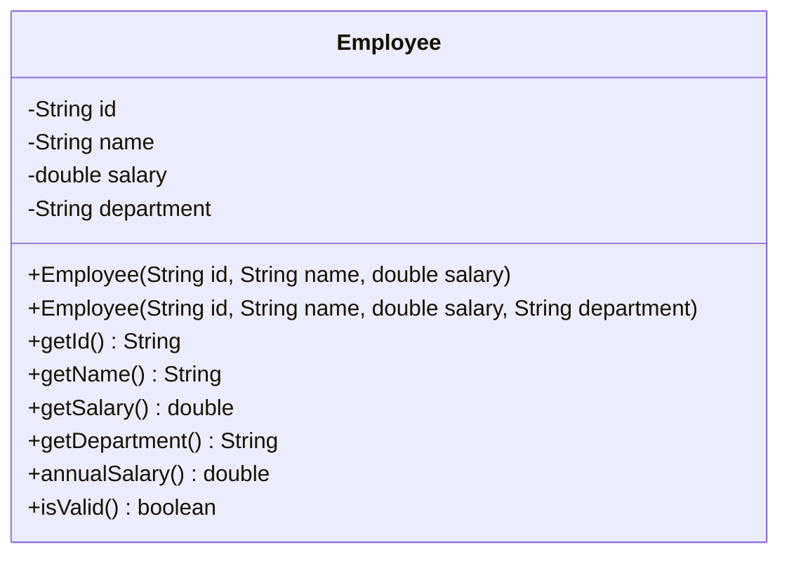

# Problem 3 — Employee (Chaining + Cross-Field Rule)

**Level:** 4 | **Lab:** Object Creation

## Context

The Level 3 `Employee` had two full-validating constructors. The refactor is straightforward — delegate the three-arg version to the four-arg one with default department. But then a **new rule** arrives: *"A Manager must have a salary of at least 100,000."*

That rule lives at the intersection of two fields. It can't be checked by `department` alone or `salary` alone. It's the first cross-field rule in the course.

## UML



## Requirements

### Two constructors — one canonical

| Constructor | Body |
|---|---|
| `Employee(id, name, salary, department)` | **Canonical** — all validation, including the cross-field rule |
| `Employee(id, name, salary)` | **Delegating** — `this(id, name, salary, "General");` |

### Validation rules

**Individual fields:**
- `id` — not blank
- `name` — valid person name
- `salary` — > 0
- `department` — not blank

**Cross-field:**
- If `department.equalsIgnoreCase("Manager")` and `salary < 100000` — reject by leaving `department` at its default (`null`).

Order matters: apply the individual rules first, then the cross-field rule. If a field is already invalid, the cross-field check has nothing reliable to work with.

## Sample interaction

```
--- Valid Manager ---
ID: E1
Name: John
Salary: 150000
Department: Manager
Employee: John (E1), Manager, salary Rs.150,000.00, isValid true

--- Invalid Manager (salary too low) ---
ID: E2
Name: Sara
Salary: 50000
Department: Manager
Employee: Sara (E2), dept=null, isValid false
```

## Chirp methods used

- [`Check.isName(String)`](http://hyphensaad.github.io/chirp/javadoc/chirp/text/Check.html#isName(java.lang.String))
- [`Check.notBlank(String)`](http://hyphensaad.github.io/chirp/javadoc/chirp/text/Check.html#notBlank(java.lang.String))
- [`Check.inRange(double, double, double)`](http://hyphensaad.github.io/chirp/javadoc/chirp/text/Check.html#inRange(double,double,double))
- [`Chirp.readNonEmpty(prompt)`](http://hyphensaad.github.io/chirp/javadoc/chirp/Chirp.html#readNonEmpty(java.lang.String))
- [`Chirp.readDouble(prompt, min, max)`](http://hyphensaad.github.io/chirp/javadoc/chirp/Chirp.html#readDouble(java.lang.String,double,double))
- [`Chirp.rupees(amount)`](http://hyphensaad.github.io/chirp/javadoc/chirp/Chirp.html#rupees(double))

## Tests to pass

- `threeArgDelegatesWithGeneralDepartment`
- `fourArgStoresProvidedDepartment`
- `managerWithHighSalaryAccepted`
- `managerWithLowSalaryRejected`
- `nonManagerWithAnySalaryAccepted`
- `invalidIdRejectedByBothConstructors`
- `invalidDepartmentRejected`

## Files

`starter/` · `solution/` · `tests/`
