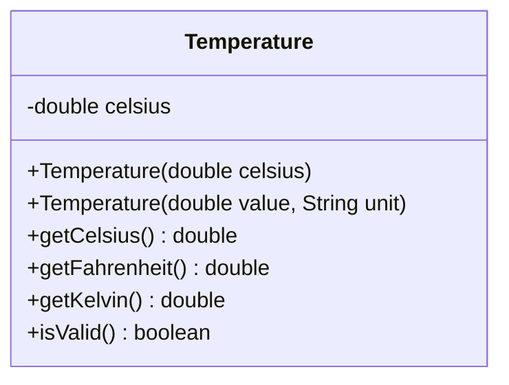

# Problem 4 — Temperature (The `this(...)` Gotcha)

**Level:** 4 | **Lab:** Object Creation

## Context

You've seen `this(...)` delegate between constructors. Now the twist: **Temperature's delegating constructor needs to compute a value before it can delegate**.

```java
public Temperature(double value, String unit) {
    this(convert(value, unit));   // but convert() is a method — can you call it?
}
```

You **cannot** call `convert(...)` if it's an instance method — `this(...)` must be the very first statement, so the object isn't constructed yet. The fix: make `convert` a `static` helper.

## UML



## Requirements

### Two constructors — one canonical

| Constructor | Body |
|---|---|
| `Temperature(double celsius)` | **Canonical** — validates and stores |
| `Temperature(double value, String unit)` | **Delegating** — calls `this(convertToCelsius(value, unit));` |

### The static helper

```java
private static double convertToCelsius(double value, String unit) {
    if (unit == null) return -999;   // sentinel for "invalid"
    return switch (unit.trim()) {
        case "C", "Celsius" -> value;
        case "F", "Fahrenheit" -> (value - 32) * 5.0 / 9.0;
        case "K", "Kelvin" -> value - 273.15;
        default -> -999;             // unknown unit → sentinel
    };
}
```

Why `-999`? Because `-999` is below absolute zero (`-273.15`), so when the canonical constructor receives it, `Check.inRange(-999, -273.15, Double.MAX_VALUE)` returns `false` — the value is rejected, and `celsius` stays at `0.0`.

That's **one** sentinel value doing two jobs:
- Signaling "unknown unit" (via the default branch)
- Signaling "below absolute zero" (via the canonical check)

Both end up with `celsius = 0.0` and `isValid()` returning... hmm, wait. `0.0` IS in range `[-273.15, ∞)`. So `isValid()` returns `true` even though the input was bad.

Is that OK? **Yes** — because "the object wasn't constructed with that input" is the outcome. The constructor rejected the invalid input and left the field at its default. A `Temperature` at `0°C` is a valid object; the fact that you *tried* to construct a `-999°C` object and failed silently is a separate concern (which `isValid()` doesn't track).

This is a deliberate simplification from Levels 2–3 where **`isValid()` was a per-field check**. Here it's "is the current state valid", and yes, `0°C` is valid.

### Behaviour

- `getCelsius()` — stored value
- `getFahrenheit()` = `celsius * 9/5 + 32`
- `getKelvin()` = `celsius + 273.15`

## Sample interaction

```
--- Celsius ---
Celsius: 25
25.00 C = 77.00 F = 298.15 K

--- Fahrenheit ---
Fahrenheit: 212
100.00 C = 212.00 F = 373.15 K

--- Below absolute zero ---
Celsius: -300
0.00 C  (invalid input — constructor rejected it, kept default 0)
```

## Chirp methods used

- [`Check.inRange(double, double, double)`](http://hyphensaad.github.io/chirp/javadoc/chirp/text/Check.html#inRange(double,double,double))
- [`Chirp.readDouble(prompt, min, max)`](http://hyphensaad.github.io/chirp/javadoc/chirp/Chirp.html#readDouble(java.lang.String,double,double))
- [`Chirp.decimal(value, places)`](http://hyphensaad.github.io/chirp/javadoc/chirp/Chirp.html#decimal(double,int))

## Tests to pass

- `celsiusConstructorStoresValue`
- `fahrenheitConstructorDelegatesAndConverts`
- `kelvinConstructorDelegatesAndConverts`
- `unitLongNamesAccepted`
- `unknownUnitResultsInDefaultZero`
- `belowAbsoluteZeroResultsInDefaultZero`
- `validTemperatureConvertsCorrectly`

## Files

`starter/` · `solution/` · `tests/`
