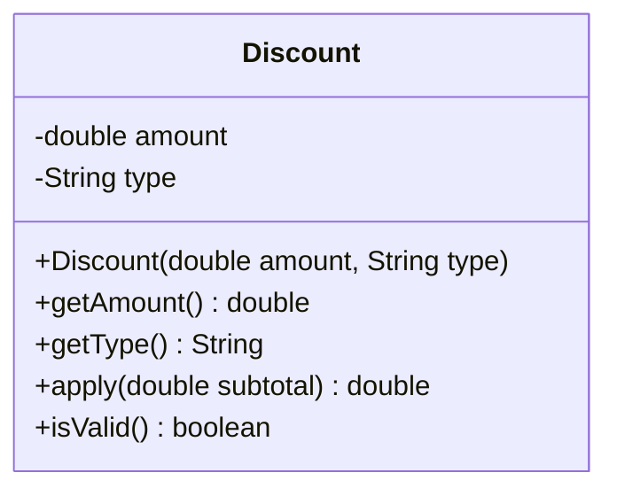

# Problem 5 — Discount (Multi-Field Validation)

**Level:** 4 | **Lab:** Object Creation

## Context

The final problem. A `Discount` has an **amount** and a **type** — `PERCENT` (0–100) or `FIXED` (any positive value). The validation rule that applies to `amount` **depends on** `type`. That's the definition of a multi-field rule.

This problem has no `this(...)` — it's the "complex validation" half of Level 4.

## UML



## Requirements

### One constructor — canonical

```java
public Discount(double amount, String type)
```

Only one constructor. The overloads would be `Discount.percent(...)` / `Discount.fixed(...)` — those come in Lab 4 (static factory methods). Here we focus on the validation.

### Validation rules

**Step 1 — validate the type:**

| Type | Recognized values |
|---|---|
| Percentage | `"PERCENT"`, `"PCT"`, `"%"` |
| Fixed | `"FIXED"`, `"AMOUNT"`, `"RS"` |

Anything else → leave `type = null` (invalid).

**Step 2 — validate the amount *based on* type:**

| Type | Amount rule |
|---|---|
| Percentage | `0 ≤ amount ≤ 100` |
| Fixed | `amount ≥ 0` |

**Step 3 — canonicalize the type:**

Store `"PERCENT"` or `"FIXED"` in the field — regardless of which synonym the caller used. That way `getType()` always returns a consistent value, and `apply()` has two cases, not six.

### Behaviour

- `apply(subtotal)`:
  - `PERCENT` → `subtotal * (1 - amount / 100)`
  - `FIXED` → `max(0, subtotal - amount)` — the discount can't push the price below zero
  - If invalid → return `subtotal` unchanged

## Sample interaction

```
--- 10% off ---
Amount: 10
Type: PERCENT
Discount: 10.00% off
Subtotal Rs.1000.00 → Rs.900.00

--- 250 off ---
Amount: 250
Type: FIXED
Discount: Rs.250.00 off
Subtotal Rs.1000.00 → Rs.750.00

--- 250 off, subtotal 100 ---
Subtotal Rs.100.00 → Rs.0.00  (capped)

--- 150% off (invalid) ---
Amount: 150
Type: PERCENT
isValid false — invalid discount ignored, subtotal unchanged
```

## Chirp methods used

- [`Check.inRange(double, double, double)`](http://hyphensaad.github.io/chirp/javadoc/chirp/text/Check.html#inRange(double,double,double))
- [`Chirp.readDouble(prompt, min, max)`](http://hyphensaad.github.io/chirp/javadoc/chirp/Chirp.html#readDouble(java.lang.String,double,double))
- [`Chirp.readNonEmpty(prompt)`](http://hyphensaad.github.io/chirp/javadoc/chirp/Chirp.html#readNonEmpty(java.lang.String))
- [`Chirp.rupees(amount)`](http://hyphensaad.github.io/chirp/javadoc/chirp/Chirp.html#rupees(double))
- [`Chirp.percent(value, places)`](http://hyphensaad.github.io/chirp/javadoc/chirp/Chirp.html#percent(double,int))

## Tests to pass

- `percentDiscountAppliesCorrectly` — 10% of 1000 → 900
- `fixedDiscountAppliesCorrectly` — 250 of 1000 → 750
- `fixedDiscountCappedAtSubtotal` — 250 of 100 → 0, not -150
- `percentAbove100Rejected`
- `percentNegativeRejected`
- `fixedNegativeRejected`
- `unknownTypeRejected`
- `typeSynonymNormalizedToCanonical` — `"PCT"` becomes `"PERCENT"`

## Files

`starter/` · `solution/` · `tests/`
